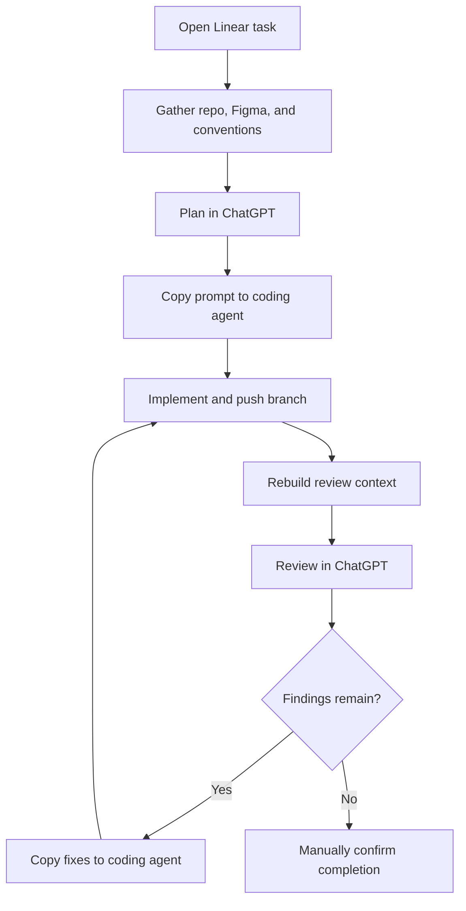
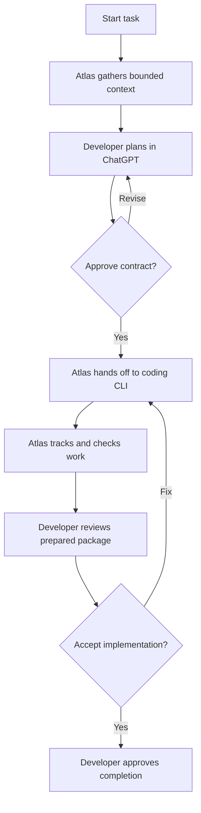
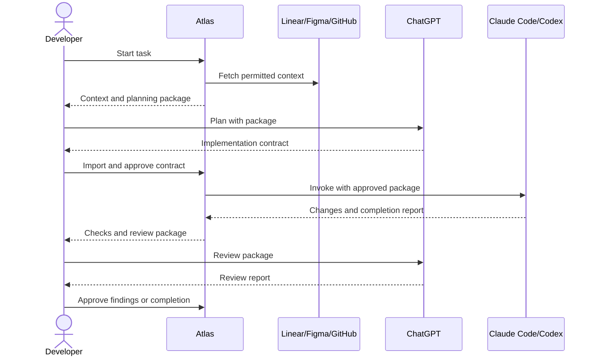
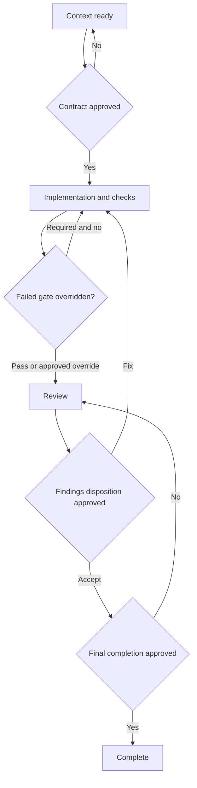
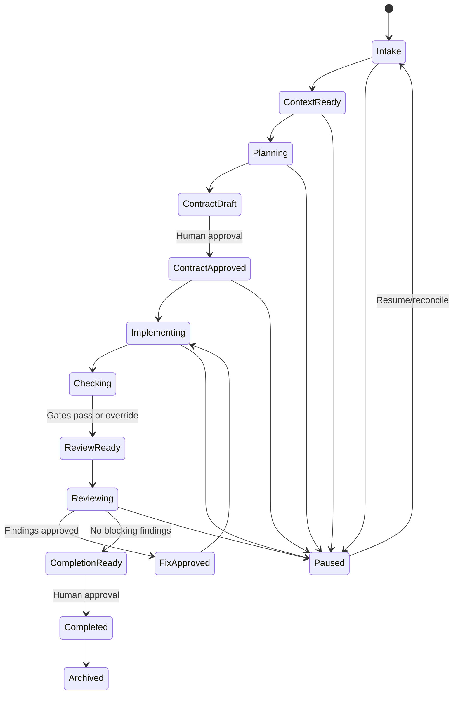
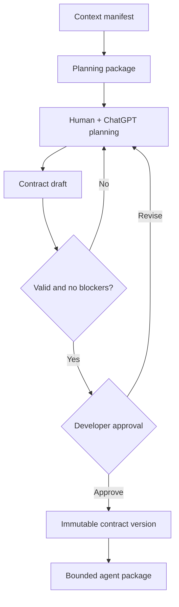
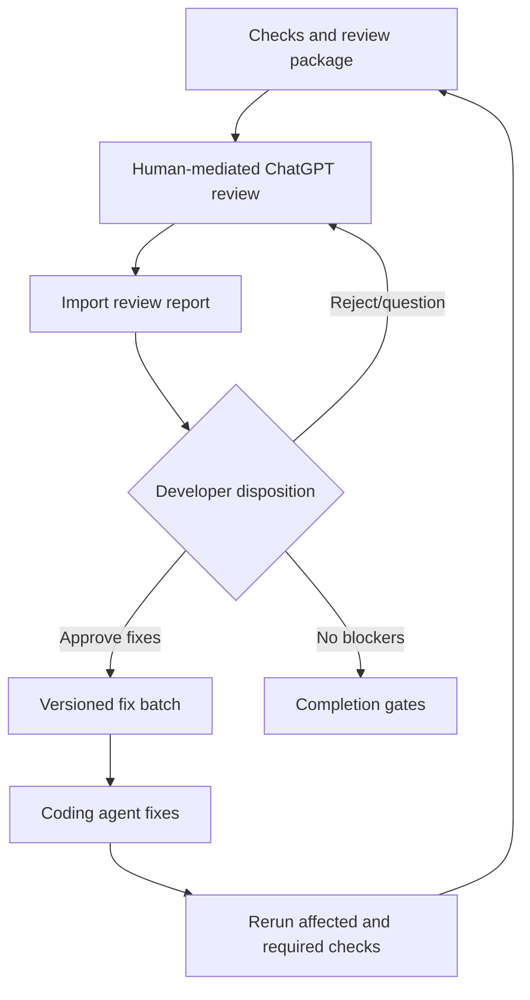
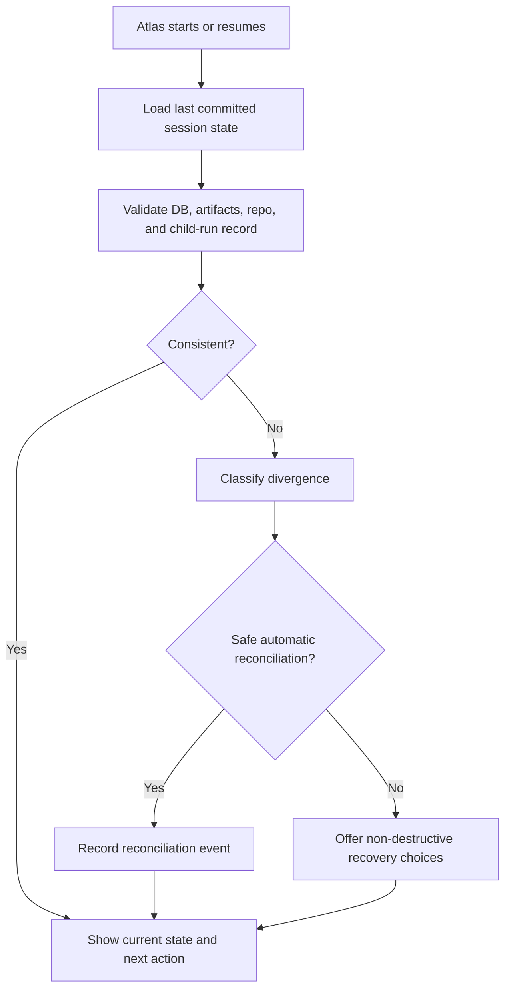
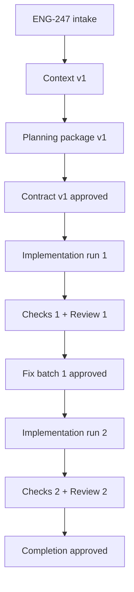

# Atlas V1 Product Requirements Document

## 1. Document control

| Field | Value |
| --- | --- |
| Product | Atlas |
| Document | V1 Product Requirements Document |
| Version | 1.0 |
| Status | Draft for product and technical review |
| Date | 12 July 2026 |
| Product owner | TBD |
| Technical owner | TBD |
| Reviewers | Product, Staff Engineering, Developer Experience, Security, Design Systems |
| Intended audience | Product managers, engineers, security reviewers, developer-experience engineers, and implementation agents |

### Revision history

| Version | Date | Author | Change |
| --- | --- | --- | --- |
| 1.0 | 12 July 2026 | Product/Engineering | Initial implementation-ready V1 PRD |

## 2. Executive summary

Atlas is a local-first command-line workflow orchestrator for AI-assisted software development. It coordinates context, decisions, artifacts, state, and handoffs across Linear, a local Git repository, GitHub, Figma, ChatGPT, Claude Code, and Codex. Atlas is not a coding agent, issue tracker, design tool, or autonomous project manager.

The V1 product replaces a fragile copy-and-paste workflow with a durable, task-centric session. Given a Linear issue or a manually created task, Atlas collects bounded context, generates a planning package, captures and versions an approved implementation contract, hands that contract to an installed coding-agent CLI, tracks local implementation activity, runs deterministic checks, assembles a review package, records review findings, and manages fix iterations until completion gates pass.

V1 is deliberately human-in-the-loop. ChatGPT planning and review are human-mediated unless the user separately configures an officially supported API. Atlas may open an application or URL and copy prepared Markdown, but it does not control a consumer ChatGPT browser session. Product decisions, material architecture choices, contract approval, accepted deviations, destructive Git actions, and final completion remain under explicit developer control.

The V1 outcome is successful when an engineer can stop and resume a complex task without reconstructing context, can see exactly which contract and code state are under review, and spends materially less time moving information between tools without weakening quality or control.

## 3. Product vision

Atlas gives a developer one local, durable interface for coordinating an engineering task from intake to final approval.

The developer owns judgment. Atlas owns coordination.

Atlas should make the approved intent, implementation state, evidence, and remaining work inspectable at any point. Handoffs should use versioned artifacts rather than ephemeral chat messages. Integrations should be replaceable adapters so that the workflow is not coupled to one AI provider or SaaS product.

## 4. Background and current workflow

Today, a developer manually gathers an issue, repository state, Figma references, conventions, and relevant code; explains them in a planning conversation; transfers the resulting plan to a coding agent; inspects the implementation; reconstructs the context for review; copies findings back to the agent; and remembers which decisions and iterations are current.



This process has no durable source of truth outside the developer's memory, chats, Git history, and scattered files. Approved decisions can be confused with provisional discussion. The reviewed diff can drift from the approved plan. Resuming after interruption requires costly reconstruction.

## 5. Problem statement

Experienced engineers using multiple AI and development tools spend excessive time coordinating those tools rather than making product and technical decisions. Existing products each hold only part of the task state and do not provide a local, auditable workflow spanning intake, planning, implementation, validation, review, and fixes.

The result is:

- repeated context gathering and copy-and-paste;
- weak continuity between sessions and tools;
- inconsistent implementation prompts and review inputs;
- hidden or stale assumptions;
- difficulty proving that an implementation matches the approved intent;
- manual tracking of branches, commits, tests, findings, and approvals;
- increased risk of design-system, architecture, permission, and edge-state omissions; and
- cognitive load from acting as a message carrier between AI systems.

## 6. Product opportunity

Atlas can create a reliable coordination layer without requiring a new model, IDE, cloud service, or paid model API. A deterministic local state machine, structured artifacts, supported CLIs, official SaaS APIs, and explicit human gates can remove repeated work while preserving developer control.

The initial wedge is a single experienced engineer working in one large SaaS repository. The product can later support richer integrations, automated model APIs, team collaboration, and visual interfaces without invalidating the V1 task and artifact model.

## 7. Personas and primary user profile

### Primary persona: experienced SaaS frontend engineer

The primary user works in a large Next.js, React, and TypeScript codebase with Tailwind CSS, GraphQL, Redux, a formal design system, reusable UI primitives, GitHub, Linear, and Figma. They regularly implement multi-state product features and use ChatGPT for planning or review and Claude Code or Codex for implementation.

They are comfortable with terminals and Git, expect to inspect and override automation, and value design fidelity, codebase conventions, security, and test evidence. Their primary need is reduced coordination overhead—not simplified coding.

### Secondary persona: staff or lead reviewer

A senior reviewer may inspect an Atlas session, approved contract, diff summary, evidence, deviations, and unresolved findings. V1 does not support multi-user collaboration, but artifacts should be readable and portable enough for review.

## 8. Jobs to be done

1. When I start a task, gather the relevant product, design, repository, and project-rule context so I can plan from a trustworthy baseline.
2. When planning concludes, preserve the exact approved implementation contract so agents and reviewers use the same intent.
3. When I hand work to a coding agent, provide only the relevant approved context and required completion evidence.
4. While implementation is running, track the branch, changes, commands, tests, deviations, and blockers without forcing me to read raw logs.
5. Before review, run deterministic checks and package the contract, diff, results, and evidence consistently.
6. When review finds problems, turn approved findings into focused fix instructions and retain iteration history.
7. When I return after an interruption, restore the last valid state and tell me the safest next action.
8. Before completion, prove that required gates pass and clearly identify any overrides or accepted deviations.

## 9. User pain points

| Pain point | Consequence | V1 response |
| --- | --- | --- |
| Context is scattered | Planning begins with omissions or stale assumptions | Bounded context manifest with source references and freshness metadata |
| Handoffs are copied manually | Prompts drift and inputs are lost | Versioned Markdown and JSON artifacts with clipboard export |
| Chat decisions are ambiguous | Agents implement provisional ideas | Immutable approved contract versions and explicit gates |
| Tool state is fragmented | Resuming requires reconstruction | Durable local task session and deterministic resume |
| Review is inconsistent | Important states or constraints are missed | Standard review package and contract-based review rubric |
| Agent output is opaque | Developer must inspect logs to understand status | Structured execution report plus concise status summaries |
| UI work becomes generic | Design tokens and existing components are bypassed | Reuse mappings, token checks, state requirements, and deviation reporting |
| Fix loops lose history | The same issues recur or are silently dropped | Versioned findings, dispositions, fix batches, and re-review cycles |

## 10. Product principles

1. **Local-first:** Sessions, metadata, and artifacts are local by default. Remote access occurs only for configured integrations or explicit user actions.
2. **Task-centric:** One Linear issue or manual task maps to one durable session.
3. **Human-controlled:** Atlas does not make irreversible product, architecture, Git, merge, or completion decisions without explicit policy and approval.
4. **Deterministic:** The core is a workflow engine and state machine; AI inference is not required for V1 correctness.
5. **Vendor-neutral:** External tools are replaceable adapters with capability checks and normalized results.
6. **Artifact-driven:** Durable, versioned artifacts are the source of truth for handoffs.
7. **Resumable:** A terminated process must not corrupt the task or make the next action ambiguous.
8. **Auditable:** Sources, actors, timestamps, versions, commands, commits, approvals, overrides, and findings are traceable.
9. **Efficient:** The common path is concise; detail is available on demand.
10. **Reuse-first:** Atlas should reinforce existing project and design-system conventions instead of encouraging generic implementation.

## 11. Goals

### V1 goals

- Create and resume a complete task session from a Linear issue or manual input.
- Reduce repeated context preparation across planning, implementation, and review.
- Establish one approved, versioned implementation contract as the source of truth.
- Invoke supported installed Claude Code or Codex CLIs through interchangeable adapters.
- Track local Git and execution state without taking destructive actions.
- Run configurable deterministic checks and enforce review-readiness gates.
- Support human-mediated ChatGPT planning and review without requiring model API spend.
- Preserve an auditable history of decisions, approvals, implementation, reviews, and fixes.
- Improve adherence to project conventions and design-system constraints.

### Outcome targets

- At least 80% of pilot tasks can resume after process termination without manual state reconstruction.
- Median human time spent preparing repeated handoffs is reduced by at least 50% in pilot measurement.
- 100% of implementation runs reference an approved contract version.
- 100% of review-ready states include the diff base, current HEAD, required check results, and contract hash.
- No destructive Git or merge action occurs without explicit confirmation in V1.

## 12. Non-goals

V1 does not include:

- fully autonomous software development or product decision-making;
- replacement of developer judgment, an IDE, issue tracker, design tool, coding model, or GitHub Actions;
- automatic code merge, force push, branch deletion, reset, rebase, or discard of local changes;
- cloud-hosted orchestration, server infrastructure, distributed execution, or background workers;
- multi-user, multi-team, or multi-organization collaboration;
- billing, account management, model training, or fine-tuning;
- general browser automation or control of consumer ChatGPT sessions;
- a complex graphical interface;
- pixel-perfect visual comparison without defined evidence and tooling;
- support for every coding agent; or
- required use of separately billed AI APIs.

## 13. Assumptions

- The user has Node.js, Git, and at least one supported coding-agent CLI installed or can install them.
- The repository is available locally and uses Git.
- The user can authenticate to enabled SaaS integrations with credentials permitted by their organization.
- Linear is the initial task source, but manual task creation remains available.
- Git is the source of truth for code changes; Atlas metadata does not replace Git history.
- ChatGPT planning and review are manual handoffs in V1 unless an official API adapter is explicitly configured.
- Project commands and conventions differ and must be configured or discovered with user confirmation.
- Figma metadata availability depends on credentials, permissions, API support, and referenced node accessibility.
- V1 targets macOS, Linux, and Windows, with Windows support including PowerShell and Git-based repositories; shell-specific behavior requires validation.

## 14. Constraints

- Core V1 must function without paid model API calls.
- Atlas cannot assume consumer subscriptions grant API access.
- Atlas must not claim or attempt hidden browser/session access.
- Local secrets must not be stored in session artifacts or committed project files.
- Large repositories require bounded, incremental context collection.
- CLI adapters must tolerate tool version differences and unavailable capabilities.
- V1 is single-user and single-machine; moving sessions between machines is a manual export/import concern, not transparent sync.
- Product requirements constrain behavior but do not prescribe a complete internal architecture.

## 15. Definitions and terminology

| Term | Definition |
| --- | --- |
| Task session | Durable local record representing one engineering task and its workflow state |
| Project memory | Confirmed repository-level configuration, rules, commands, and references reusable across sessions |
| Task memory | Context, artifacts, decisions, implementation state, and review history for one task |
| User preferences | Local defaults controlling interaction and presentation |
| Context manifest | Bounded inventory of selected sources, fingerprints, relevance notes, freshness, and exclusions |
| Planning package | Structured input prepared for the developer's planning conversation |
| Implementation contract | Versioned, validated agreement defining approved scope, decisions, constraints, tests, and completion conditions |
| Approval gate | State transition requiring explicit human confirmation |
| Execution run | One invocation of a coding-agent adapter against an approved contract or fix package |
| Review package | Contract, diff, evidence, check results, deviations, and instructions prepared for review |
| Finding | Review observation classified as blocking, important, suggestion, question, or accepted deviation |
| Override | Explicit, attributed decision to proceed despite a failed or waived gate |
| Adapter | Replaceable integration implementing a normalized capability interface |

## 16. Existing workflow versus target workflow

| Concern | Existing workflow | Atlas-assisted V1 |
| --- | --- | --- |
| Intake | Open and interpret issue manually | Fetch or enter task; persist normalized snapshot |
| Context | Recollect for each tool | Build once, fingerprint, reuse, and refresh selectively |
| Planning | Free-form conversation | Structured package plus human conversation |
| Decision record | Buried in chat | Versioned contract and decision log |
| Agent handoff | Copy ad hoc prompt | Adapter receives approved contract package |
| Tracking | Terminal, memory, and Git | Structured run records backed by Git facts |
| Validation | Inconsistent commands | Configured checks with recorded outcomes |
| Review | Recreate prompt and diff | Standard package tied to contract and commit range |
| Fixes | Copy findings and repeat | Approved finding set becomes a versioned fix batch |
| Resume | Reconstruct manually | Restore last valid state and recommended next action |



## 17. End-to-end V1 user journey

1. The developer runs `atlas start ENG-247` from a configured repository.
2. Atlas verifies the project, fetches the issue, detects references, creates the session, and reports missing or stale context.
3. The developer runs `atlas context` to inspect or refresh the selected sources.
4. `atlas plan` writes a planning package, copies it if configured, and optionally opens the configured ChatGPT URL or application.
5. The developer conducts the planning conversation and imports the final contract with `atlas contract import`.
6. Atlas validates the contract and displays blocking questions. The developer explicitly approves a valid version.
7. `atlas implement` verifies Git safety, creates or selects a task branch with confirmation when necessary, and invokes the chosen installed coding-agent CLI.
8. Atlas captures normalized execution results and reconciles them with Git and command evidence.
9. `atlas checks` runs configured deterministic checks. Failed required checks block review-ready status unless explicitly overridden with a recorded reason.
10. `atlas review` creates a review package for human-mediated ChatGPT review. The developer imports the resulting report.
11. The developer accepts, rejects, or reclassifies findings. `atlas fix` sends only approved actionable findings and relevant contract context to the agent.
12. Checks and review repeat against a new iteration.
13. `atlas complete` evaluates gates and presents evidence, overrides, and unresolved items. The developer approves completion or chooses another action.

## 18. Workflow stages and human approval gates

### Responsibility overview



### Automation boundary

| Operation | V1 mode | Human gate |
| --- | --- | --- |
| Read configured Linear issue and metadata | Automated | Initial credential and project configuration |
| Discover local repository facts | Automated | None for read-only discovery |
| Select context | Assisted | User can inspect, exclude, or refresh |
| Plan in ChatGPT | Manual handoff | Developer conducts and owns conversation |
| Import and validate contract | Assisted | Explicit approval required |
| Create a new task branch | Assisted | Confirmation if not pre-authorized by safe policy |
| Invoke installed coding-agent CLI | Automated after command | Command itself is explicit authorization; adapter shows scope |
| Run configured checks | Automated | Override requires confirmation and reason |
| Review in ChatGPT | Manual handoff | Developer imports and owns review decision |
| Send approved fixes to coding agent | Assisted | Finding disposition and invocation are explicit |
| Mark ready or complete | Assisted | Explicit final approval required |
| Create/update pull request | Deferred or optional assisted extension | Explicit confirmation |
| Merge, force push, discard work | Not supported | N/A |

### Human approval gates



## 19. Functional requirements

The following requirements are the V1 product baseline. “V1 status” indicates scope commitment, not implementation progress.

### 19.1 Installation, initialization, and configuration

| ID | Requirement and user value | Priority | Preconditions and trigger | Main behavior and outputs | Failure behavior | Acceptance criteria | V1 status |
| --- | --- | --- | --- | --- | --- | --- | --- |
| AT-SET-001 | **Installable CLI.** The user can install and invoke Atlas consistently. | P0 | Supported Node/runtime; user runs install and `atlas --version`. | Provide versioned executable, help, and shell-safe exit codes. | Explain unsupported runtime or path conflicts without mutation. | Clean install succeeds on supported OS matrix; `--version` and `--help` exit 0 within 1 second initial target. | Committed |
| AT-SET-002 | **Project initialization.** Create explicit project configuration without overwriting files. | P0 | Git repository; `atlas init`. | Discover safe defaults, preview configuration, write only after confirmation, and support non-interactive flags. | Invalid repo or collision leaves existing files unchanged and shows recovery. | Re-running is idempotent; existing configuration is preserved unless an explicit update is accepted. | Committed |
| AT-SET-003 | **Configuration validation.** Prevent invalid commands and unsafe assumptions. | P0 | Config exists; any state-changing command. | Validate schema, paths, commands, adapters, branch rules, and secret references; output actionable diagnostics. | Block the affected action; do not partially mutate session or repo. | Every invalid field names its source, expected form, and correction; `atlas doctor` detects missing dependencies. | Committed |
| AT-SET-004 | **Layered configuration.** Separate project rules from user preferences and secrets. | P0 | Initialization or config change. | Merge documented defaults, user config, project config, and command flags with visible precedence. | Reject ambiguous or unknown security-sensitive fields. | `atlas config explain <key>` reports value and source; secrets never appear in project config. | Committed |

### 19.2 Authentication and credentials

| ID | Requirement and user value | Priority | Preconditions and trigger | Main behavior and outputs | Failure behavior | Acceptance criteria | V1 status |
| --- | --- | --- | --- | --- | --- | --- | --- |
| AT-AUTH-001 | **Safe credential storage.** Enable integrations without exposing tokens. | P0 | User enables an authenticated adapter. | Store token in OS keychain where available; allow environment-variable reference for automation; store only a credential alias in config. | If secure storage is unavailable, require an explicit documented alternative; never silently write plaintext. | Token values are redacted in all output, logs, artifacts, crash reports, and JSON. | Committed |
| AT-AUTH-002 | **Least-privilege verification.** Show what each credential can do. | P0 | Credential added or `doctor` runs. | Perform non-destructive auth/capability check and report identity, scopes where exposed, and missing permissions. | A failed adapter is isolated; local-only features remain usable. | Invalid/expired credentials produce provider-specific recovery instructions without exposing secrets. | Committed |
| AT-AUTH-003 | **Credential removal.** Let the user revoke Atlas's local reference. | P1 | Credential exists; user requests removal. | Remove keychain entry/reference after confirmation and mark dependent adapter unavailable. | Failure reports whether the reference or secure entry remains. | Removed credentials are not recoverable through Atlas output or artifacts. | Committed |

### 19.3 Task intake and integrations

| ID | Requirement and user value | Priority | Preconditions and trigger | Main behavior and outputs | Failure behavior | Acceptance criteria | V1 status |
| --- | --- | --- | --- | --- | --- | --- | --- |
| AT-INT-001 | **Linear issue intake.** Create a trustworthy task snapshot from an issue ID. | P0 | Linear adapter configured; `start <id>`. | Fetch permitted title, description, status, labels, comments, links, and available acceptance criteria; record source and fetch time. | Network/auth failures do not create a misleading complete session; user may retry or continue manually. | Fixture issue fields normalize to the documented task schema; unavailable fields are explicit, not fabricated. | Committed |
| AT-INT-002 | **Manual task intake.** Keep core workflow usable without Linear. | P0 | `start --manual` or Linear unavailable. | Prompt for or accept title, objective, references, repository, and optional acceptance criteria. | Validate required minimum fields and preserve draft input. | A manual task reaches context-discovery state without remote credentials. | Committed |
| AT-INT-003 | **Reference detection.** Reduce missed design and code links. | P0 | Task content imported. | Detect and normalize Figma and GitHub URLs and retain original text and source location. | Malformed or inaccessible links are flagged, not discarded. | Repeated links deduplicate by canonical target while preserving all source occurrences. | Committed |
| AT-INT-004 | **GitHub metadata.** Add PR/repository context when configured and relevant. | P1 | GitHub adapter authenticated; linked PR/repo exists. | Read permitted metadata such as default branch, PR status, commit identifiers, and links; local Git remains code source of truth. | Remote failure does not corrupt local Git facts. | Package labels remote facts with fetch time and distinguishes them from local state. | Committed |
| AT-INT-005 | **Figma reference handling.** Preserve design truth without overstating fidelity. | P0 | Figma URL detected or added. | Parse file/node identifiers, fetch official metadata when allowed, and support user-supplied exports/screenshots as evidence. | Inaccessible metadata remains a reference with clear limitation. | Atlas never labels an implementation pixel-perfect solely because a Figma URL exists. | Committed |

### 19.4 Repository and context collection

| ID | Requirement and user value | Priority | Preconditions and trigger | Main behavior and outputs | Failure behavior | Acceptance criteria | V1 status |
| --- | --- | --- | --- | --- | --- | --- | --- |
| AT-CTX-001 | **Repository verification.** Ensure commands act on the intended repository. | P0 | Project/session command. | Resolve repo root, remote identity where present, current branch, configured base, HEAD, worktree state, and nested/worktree conditions. | Repository mismatch blocks state-changing steps and offers selection/correction. | Recorded repo identity and path are shown before first implementation run. | Committed |
| AT-CTX-002 | **Bounded context manifest.** Gather relevant context without loading the entire repository. | P0 | `context build/refresh`. | Inventory selected files, symbols, rules, design docs, operations, tests, and external references with reason, size, hash, and timestamp. | Limit excess produces an explicit exclusion/overflow report and asks for narrowing. | Default package respects configured byte/file limits; every included item is traceable to a source. | Committed |
| AT-CTX-003 | **Project-rule discovery.** Consistently pass relevant conventions. | P0 | Context build. | Discover configured instruction files, design-system docs, command definitions, and directory-scoped rules; apply documented precedence. | Conflicting rules are surfaced as a blocking planning question where material. | Manifest records which rules apply to each target area and excludes unrelated instruction files. | Committed |
| AT-CTX-004 | **Freshness and selective refresh.** Avoid stale or repeated context work. | P0 | Resume, plan, implement, or review. | Compare fingerprints, Git refs, fetched-at times, and configured TTLs; refresh only stale dependencies or on request. | If required context cannot refresh, label the artifact stale and block affected gate or allow reasoned override. | Unchanged sources are not reloaded; changed required sources invalidate dependent packages. | Committed |
| AT-CTX-005 | **Large-repository safeguards.** Keep discovery responsive. | P0 | Repository exceeds configured thresholds. | Use ignore rules, path filters, Git-aware changed/related files, symbol/search limits, timeouts, and cached metadata. | Timeouts return partial traceable results rather than hanging. | Initial target: context command provides first useful summary within 5 seconds and completes bounded scan within 30 seconds for pilot repos, subject to validation. | Committed |
| AT-CTX-006 | **Context inspection and overrides.** Let the developer correct selection. | P1 | Manifest exists. | Show inclusions/exclusions and allow add, exclude, pin, or refresh actions with reasons. | Invalid paths or secret-like files are rejected or require explicit safe policy. | Manual changes are persisted in task metadata and reflected in the next package version. | Committed |

### 19.5 Sessions, artifacts, and approvals

| ID | Requirement and user value | Priority | Preconditions and trigger | Main behavior and outputs | Failure behavior | Acceptance criteria | V1 status |
| --- | --- | --- | --- | --- | --- | --- | --- |
| AT-SES-001 | **Durable task session.** Preserve workflow state across process exits. | P0 | Successful intake. | Create unique task identity, local database record, artifact directory, event history, and initial state atomically. | Partial creation is rolled back or marked recoverable; duplicate issue offers resume/new-session choice. | Forced termination between transitions leaves either previous or next valid state, never an ambiguous half-state. | Committed |
| AT-SES-002 | **Status and resume.** Tell the user where work stands and what to do next. | P0 | Existing session; `status` or `resume`. | Reconcile stored state with Git and artifacts, show gates/blockers, and recommend one or more valid next commands. | Divergence is reported before mutation and resolved through an explicit path. | Resume after terminal closure requires no re-import of unchanged approved artifacts. | Committed |
| AT-SES-003 | **Pause, archive, and cancel.** Stop coordination without deleting code. | P0 | Active session; user command. | Pause preserves state; archive removes it from active lists; cancel records reason and prevents normal progression. | Never delete branch, commits, or user files. | Each action is reversible where documented; archived sessions can be inspected and resumed after confirmation. | Committed |
| AT-ART-001 | **Versioned artifacts.** Make handoffs and decisions durable. | P0 | Artifact generated or imported. | Store immutable versions with schema version, content hash, actor/source, timestamp, parent/replaces link, and human-readable Markdown; structured JSON where required. | Invalid import is preserved as a rejected draft or left untouched; it cannot replace an approved version. | Approved artifact bytes cannot change in place; edits create a new version. | Committed |
| AT-APP-001 | **Explicit approvals.** Prevent implicit progression. | P0 | Approval-required transition. | Show artifact/version, consequences, blockers, and diff from prior approved version; record user, time, and optional rationale. | Non-interactive approval requires explicit flag/policy and remains audited; missing approval blocks transition. | No implementation run can start without an approved contract ID and hash. | Committed |
| AT-APP-002 | **Material-change detection.** Require renewed approval when intent changes. | P0 | New contract or accepted deviation. | Compare structured sections and classify scope, architecture, data, security, design-system, acceptance, or test changes as material by default. | Uncertain classification asks for explicit approval rather than silently reusing it. | Material contract versions invalidate review/completion readiness tied to older versions. | Committed |

### 19.6 Planning and implementation contracts

| ID | Requirement and user value | Priority | Preconditions and trigger | Main behavior and outputs | Failure behavior | Acceptance criteria | V1 status |
| --- | --- | --- | --- | --- | --- | --- | --- |
| AT-PLN-001 | **Planning-package generation.** Start a complete, focused planning conversation. | P0 | Intake and required context available. | Generate Markdown with goal, current/expected behavior, selected evidence, constraints, states, data, tests, decisions, and source manifest summary. | Missing required sections are listed; stale critical sources block “ready” label. | Package is deterministic for identical inputs and records input hashes. | Committed |
| AT-PLN-002 | **Manual ChatGPT handoff.** Support existing subscription workflows honestly. | P0 | Planning package exists. | Export to file, copy to clipboard, print path, and optionally open configured public/app destination. | Clipboard/open failure leaves exported artifact available with recovery command. | No V1 flow depends on controlling or reading an existing ChatGPT browser session. | Committed |
| AT-CON-001 | **Contract import and schema validation.** Convert planning output into enforceable intent. | P0 | Developer supplies file/stdin/clipboard content. | Validate required sections: objective, scope, non-scope, decisions, approach, impact, reuse, constraints, data/state, edge cases, acceptance, tests, validation, questions, prohibitions. | Show line/section errors and retain draft; blocking unresolved questions prevent approval. | A contract missing any P0 section cannot be approved. | Committed |
| AT-CON-002 | **Decision and deviation tracking.** Preserve why implementation differs. | P0 | Contract approved or deviation proposed. | Record decision status, rationale, author, affected requirements, and whether renewed approval is required. | Unapproved material deviations block review-ready/completion state. | Review package lists every known deviation and disposition. | Committed |

### 19.7 Coding-agent execution and local commands

| ID | Requirement and user value | Priority | Preconditions and trigger | Main behavior and outputs | Failure behavior | Acceptance criteria | V1 status |
| --- | --- | --- | --- | --- | --- | --- | --- |
| AT-AGT-001 | **Replaceable agent selection.** Switch workers without changing task state. | P0 | At least one adapter available; `implement --agent`. | Resolve configured/default Claude Code or Codex adapter, verify capabilities/version, and use normalized request/result schemas. | Unsupported version/capability blocks invocation and suggests another adapter or manual export. | The same approved package can be exported for both adapters without changing contract identity. | Committed |
| AT-AGT-002 | **Relevant implementation package.** Give agents approved, bounded instructions. | P0 | Approved contract and safe Git state. | Include contract, repo/base/target refs, applicable rules, component mappings, tests, prohibitions, and completion-report schema. | Oversize packages produce referenced artifacts or ask for scope narrowing; never silently truncate critical constraints. | Package records exactly which contract and source versions it contains. | Committed |
| AT-AGT-003 | **Supported CLI invocation.** Use installed tools through documented interfaces. | P0 | Adapter health check passes; user invokes implementation/fix. | Run in repository context, stream concise progress, capture exit code, timestamps, sanitized output references, and normalized completion report. | Timeout, cancellation, crash, or non-zero exit creates a failed/interrupted run that can be safely retried. | Atlas never claims success based only on agent prose; Git/check evidence is reconciled independently. | Committed |
| AT-EXE-001 | **Safe local command runner.** Run configured checks predictably. | P0 | Command is declared or explicitly approved. | Display command/scope, set working directory and timeout, capture stdout/stderr with redaction, and record result. | Refuse destructive or shell-unsafe commands outside policy; cancellation terminates child process where supported. | Commands are not interpolated through an unsafe shell by default; exit codes and duration are recorded. | Committed |
| AT-EXE-002 | **Execution report.** Summarize work without raw-log dependence. | P0 | Run ends. | Report agent, contract, branch/HEAD before and after, changed files, commands, tests, limitations, deviations, questions, and status. | Missing agent report fields are marked unknown and derived facts are labeled. | Summary is human-readable and has a stable JSON representation. | Committed |

### 19.8 Git, checks, review, and completion

| ID | Requirement and user value | Priority | Preconditions and trigger | Main behavior and outputs | Failure behavior | Acceptance criteria | V1 status |
| --- | --- | --- | --- | --- | --- | --- | --- |
| AT-GIT-001 | **Safe task branch workflow.** Isolate work without losing changes. | P0 | Approved contract; implementation requested. | Validate base ref, worktree cleanliness/policy, branch naming, and collisions; create branch only with allowed policy or confirmation. | Dirty worktree, missing base, divergence, or collision blocks and offers non-destructive choices. | Atlas does not reset, force checkout, force push, discard, delete, or merge in V1. | Committed |
| AT-GIT-002 | **Authoritative change tracking.** Tie evidence to exact Git state. | P0 | During/after execution and review. | Record base commit, branch, HEAD, commits, working-tree changes, rename/binary summary, and diff range. | If HEAD changes outside Atlas, reconcile and invalidate stale packages as needed. | Review package identifies exact base and head SHAs and whether uncommitted changes are included. | Committed |
| AT-GIT-003 | **Diff generation with safeguards.** Provide useful review context. | P0 | Review requested. | Generate changed-file summary and bounded patch; detect secrets/binaries/oversize content; reference omitted files. | Secret-like content is redacted or excluded with warning; oversized diff never silently disappears. | Package accounts for every changed path even when full content is excluded. | Committed |
| AT-CHK-001 | **Configurable deterministic checks.** Validate implementation before review. | P0 | Work exists; `checks` or review preflight. | Run configured typecheck, lint, unit/integration tests, build, Git checks, token scans, and contract-specific commands with dependency/parallel rules. | Required failure blocks review-ready state; rerun can target failed or affected checks. | Each result records command version, commit/worktree fingerprint, exit status, duration, and log reference. | Committed |
| AT-CHK-002 | **UI/design-system policy checks.** Detect common fidelity violations. | P0 for configured UI projects | Project policy configured. | Scan changed files for arbitrary Tailwind values, prohibited imports/components, missing token usage, and contract-specific mappings. | Findings identify file/rule and allow approved exception with rationale. | Known fixture violations are detected; clean fixtures pass; scanner limitations are documented. | Committed |
| AT-REV-001 | **Review-package generation.** Make review repeatable and contract-based. | P0 | Approved contract; implementation; preflight complete or overridden. | Package contract, exact diff range, change summary, checks, agent report, deviations, evidence, and review rubric. | Stale contract/diff/checks block “review-ready” label; draft package can still be generated and labeled. | Identical state generates equivalent content and fingerprints; package contains no unredacted configured secrets. | Committed |
| AT-REV-002 | **Review-report import and findings.** Turn feedback into manageable work. | P0 | Developer imports structured Markdown/JSON. | Validate reviewer context, classify findings, capture severity, evidence, target files, suggested action, and contract link; require developer disposition. | Malformed or stale review is imported as draft and cannot drive fixes until resolved. | Blocking, important, suggestion, question, and accepted-deviation classes are supported. | Committed |
| AT-FIX-001 | **Versioned fix loop.** Send only approved findings and retain iteration history. | P0 | Findings disposition approved. | Create fix batch tied to review/contract/HEAD, invoke selected agent, rerun affected/required checks, and generate next review iteration. | If Git or contract changes, invalidate stale batch and require regeneration. | Resolved findings retain evidence; reopened findings preserve history; no finding silently vanishes. | Committed |
| AT-CMP-001 | **Completion gates.** Prevent unsupported claims of done. | P0 | `complete`. | Verify approved current contract, required checks, no unresolved blocking findings, valid Git state, required evidence, and no paused/rejected status; show overrides. | Failed gates block completion; overrideable gates require explicit reason; non-overrideable corruption/security failures remain blocked. | Completion record includes exact contract, HEAD/worktree, check set, findings state, evidence, overrides, and approval. | Committed |

## 20. CLI product specification

Command names are provisional but the capability groups and behavioral contracts are V1 requirements.

### Output and interaction conventions

- Default output is concise: current state, completed action, blockers, and next command.
- `--verbose` reveals source selection, command details, timings, and reconciliation notes.
- `--json` emits a versioned schema to stdout and sends human diagnostics to stderr.
- Success exits `0`; validation/user-action errors use stable non-zero codes distinct from internal failures.
- Destructive or approval-requiring actions cannot be confirmed by an ambiguous Enter key; the prompt names the consequence.
- Non-interactive mode never waits for input. Missing required decisions fail with a machine-readable next action.
- Every state-changing command is atomic or recoverable and prints the session ID and resulting state.
- Paths are printed in an OS-appropriate form; secrets and sensitive query parameters are redacted.

### Command groups

| Command | User goal | Preconditions / inputs | Behavior and output | Errors and recovery | State change / approval |
| --- | --- | --- | --- | --- | --- |
| `atlas init` | Configure a repository | Git repo; optional flags | Discover, preview, validate, and write project config | Collision, invalid command, unsupported repo; rerun after correction | Project config changes; confirmation required |
| `atlas start <issue-id>` | Begin tracked work | Configured project and optional Linear auth | Fetch or enter task, detect links, create session | Auth/network/duplicate issue; retry, manual mode, or resume | Creates session; confirms ambiguous repo/task |
| `atlas intake` | Inspect or refresh task source | Session | Show normalized task and refresh remote snapshot | Stale/unavailable remote; retain prior labeled snapshot | New artifact version; no approval unless source materially changes approved intent |
| `atlas context [build|show|add|exclude|refresh]` | Control task context | Session and repo | Build/inspect bounded manifest and freshness | Limits, conflicts, missing paths; narrow or override safely | Manifest/package versions change; no product approval |
| `atlas plan` | Prepare planning conversation | Intake/context sufficient | Export planning package; optionally copy/open | Missing/stale context; correct or create labeled draft | Creates artifact; no approval |
| `atlas contract import/show/diff` | Capture and inspect agreement | Input file/stdin/clipboard | Validate, version, display, and compare contract | Missing sections or blockers; edit and re-import | Creates draft version; no approval on import |
| `atlas approve contract <version>` | Authorize implementation intent | Valid contract, no blocking questions | Show material changes and record approval | Stale/invalid version; refresh or choose correct version | Approval gate; explicit confirmation |
| `atlas implement` | Run coding worker | Approved contract, agent, safe Git state | Build package, prepare branch, invoke adapter, reconcile report | Dirty tree, missing CLI, crash; resolve or retry | Execution state changes; command is explicit authorization; branch confirmation as needed |
| `atlas status` | Understand current state | Optional session selector | Show stage, Git state, gates, blockers, next steps | Ambiguous session; choose one | Read-only |
| `atlas checks [--failed|--affected]` | Validate work | Configured checks | Run and record deterministic checks | Timeout/failure; inspect logs and rerun | Check records change; override separate |
| `atlas review [prepare|import|show]` | Prepare or capture review | Implementation and contract | Create package or validate report | Stale diff/checks/report; regenerate or import as draft | Artifact/findings change; readiness gate applies |
| `atlas approve findings` | Decide review disposition | Imported review | Accept classifications/actions and record deviations | Ambiguous/stale finding; resolve first | Approval gate |
| `atlas fix` | Address approved findings | Approved fix batch, safe Git | Invoke agent with focused package | Same execution/Git errors as implement | Fix iteration changes; explicit invocation |
| `atlas resume` | Continue safely | Existing session | Reconcile state and present next valid action | External divergence; select recovery | May update reconciled facts, not approvals |
| `atlas pause` | Stop active progression | Active session | Record pause reason and preserve state | Running process; cancel/wait choice | State change; confirmation only if process active |
| `atlas history` | Audit events | Session | Show filtered timeline and artifact links | Corrupt record; doctor/recovery | Read-only |
| `atlas artifacts` | Find/export evidence | Session | List versions, hashes, status, and paths | Missing file; recovery/mark missing | Read-only unless export requested |
| `atlas open <target>` | Open local/remote reference | Configured app/URL | Open editor, repo, issue, design, or artifact | Unsupported opener; print target instead | Read-only external launch |
| `atlas complete` | Approve task completion | Completion gates evaluated | Show evidence and record final approval | Failed gates; return to checks/review/fix | Approval gate |
| `atlas archive` | Remove finished/abandoned task from active view | Session not actively running | Preserve data and archive status | Active child process; stop first | State change; confirmation |
| `atlas doctor` | Diagnose setup/session | None or session | Validate runtime, tools, credentials, config, DB, artifact links | Provides scoped repair steps | Read-only unless `--repair` explicitly selected |
| `atlas config` | Inspect/change settings | Relevant scope | Explain sources, validate updates, redact secrets | Invalid value; no partial write | Mutating subcommands require confirmation as appropriate |

## 21. Task-session and memory requirements

### Memory layers

| Layer | Remember | Do not remember by default | Update and freshness policy |
| --- | --- | --- | --- |
| Task memory | Issue snapshots, references, context manifests, planning artifacts, decisions, approved contracts, Git refs, runs, checks, reviews, fixes, status | Unrelated repository content, raw secrets, full chat history unless explicitly imported, unrelated personal data | Immutable event/artifact history; current projections rebuilt from events; source fingerprints invalidate dependents |
| Project memory | Repo identity, base-branch policy, commands, scoped conventions, architecture/design docs, component registry, test rules, exclusions, default agent | Tokens, private issue content, task-specific decisions promoted without confirmation | User-confirmed changes are versioned; Git-tracked sources use content hashes; stale when file/ref/config changes |
| User preferences | Preferred agent/editor, verbosity, open/copy defaults, strictness, approval preferences | Project secrets, sensitive content, implicit behavioral profiles | Explicit changes only; defaults can be reset and exported without secrets |

Project memory promotion must be explicit. Atlas may suggest that a recurring task rule become project memory, but it must not silently generalize one task's decision. Staleness is detected using content hashes, Git refs, file metadata as an optimization, integration fetch timestamps, adapter versions, and configuration schema versions.

### Task-session state model



The actual implementation may use substates, but every externally visible transition must be deterministic, validated, and recorded. “Paused,” “cancelled,” “abandoned,” and “archived” are status overlays or terminal dispositions with defined resume rules; they must not erase the last valid workflow stage.

## 22. Artifact and contract requirements

### Required artifact set

| Artifact | Format | Producer | Required before | Key contents |
| --- | --- | --- | --- | --- |
| Task brief | Markdown + structured data | Atlas | Context discovery | Normalized task, sources, gaps |
| Context manifest | Markdown + JSON | Atlas | Planning | Selected sources, hashes, freshness, limits, exclusions |
| Planning package | Markdown | Atlas | Planning conversation | Goal, behavior, evidence, constraints, states, decisions |
| Decision log | Markdown + JSON | Developer/Atlas | Ongoing | Decision, status, rationale, actor, affected contract |
| Implementation contract | Markdown + JSON metadata | ChatGPT/developer import | Implementation | Approved intent, constraints, tests, prohibitions |
| Execution report | Markdown + JSON | Agent adapter/Atlas | Checks/review | Run facts, changes, commands, deviations, blockers |
| Test/check report | Markdown + JSON | Atlas | Review/completion | Results tied to code fingerprint |
| Review package | Markdown | Atlas | Review conversation | Contract, diff, evidence, rubric |
| Review report | Markdown + JSON metadata | ChatGPT/developer import | Finding disposition | Findings, severity, evidence, action |
| Fix instructions | Markdown | Atlas | Fix run | Approved findings and bounded context |
| Completion report | Markdown + JSON | Atlas | Archive/PR handoff | Final contract, code, gates, evidence, approvals |

Every artifact has a stable artifact ID, session ID, type, schema version, content version, content hash, creation time, producer type, producer identifier where available, source/parent versions, approval state, and sensitivity classification. Markdown is optimized for humans and agent handoffs; structured metadata supports validation and automation.

### Planning-to-implementation handoff



## 23. Integration requirements

### Linear

- Use official APIs and least-privilege credentials.
- V1 reads issues, comments, labels, status, links, and available relationships required for intake.
- Normalize provider data while preserving original IDs, URLs, source times, and raw-field availability.
- Retry safe reads with bounded exponential backoff and respect provider rate limits.
- Writing status updates or comments is deferred; any later write must require a preview and explicit authorization.

### Git and GitHub

- Local Git is authoritative for working-tree, branch, commit, and diff facts.
- GitHub supplements remote repository and pull-request metadata when configured.
- V1 supports work before a PR exists. PR preparation may be exported as a completion artifact; direct creation is P2 unless implemented through an official supported interface with confirmation.
- Atlas never assumes `origin`, default branch, or branch protection without verification.
- Remote fetch is explicit/configurable and must not silently alter the worktree.

### Figma

- Store canonical file and node references and fetched metadata with timestamps.
- Use official credentials/APIs only when configured.
- Accept exported screenshots, annotations, or other user-supplied visual evidence and link them to the relevant frame and contract version.
- Report access limitations and avoid inferring unobserved interaction, responsiveness, or component behavior.

### ChatGPT

- V1's default integration is artifact export, clipboard assistance, optional app/URL opening, and artifact import.
- The developer is responsible for submitting the package and selecting/importing the final response.
- An optional future official API adapter must be separately configured, disclose cost and data transfer, and not replace approval gates.
- Atlas must not automate login, scrape chats, inject browser scripts, or imply access to consumer chat history.

### Claude Code and Codex

- Each adapter declares executable discovery, supported versions/capabilities, invocation modes, cancellation behavior, output parsing, and completion-report support.
- Atlas passes the same normalized implementation/fix contract through provider-specific formatting.
- Provider-specific session IDs may be recorded, but Atlas session identity and workflow state remain provider-neutral.
- If structured output is unavailable, Atlas captures exit state and reconciles Git facts; unverified agent claims are labeled as such.

## 24. Git and branch workflow requirements

1. The project defines a default base branch and optional branch naming template, for example `feat/{issue-id}-{slug}`.
2. Before branch creation Atlas verifies repository identity, resolves the base commit, checks worktree status, and detects existing local/remote names.
3. A pre-existing correct task branch may be adopted after showing its base, divergence, and worktree state.
4. Uncommitted pre-existing work is never stashed, committed, moved, or discarded automatically. Atlas offers to pause, adopt with explicit acknowledgment, or let the user resolve it.
5. Branch creation and checkout use non-destructive Git operations. Failure leaves the original branch and worktree intact.
6. Atlas records base commit at contract approval/implementation start. A later base update is a new explicit action and may invalidate checks or review packages.
7. Diff review can include committed-only or committed-plus-worktree state, but the package must state which.
8. Atlas tracks commits but does not require agents to commit unless project policy says so. It never authors a commit without an explicit user command/policy and a visible message.
9. Pull-request creation/update is not required for core V1 completion. Atlas produces the information needed for a PR and may add a supported, confirmed P2 adapter.

## 25. Planning and implementation-contract requirements

The implementation contract is the authoritative product-to-execution handoff. It must contain:

1. objective and user outcome;
2. in-scope and out-of-scope behavior;
3. approved product and technical decisions;
4. proposed technical approach at subsystem level;
5. files/subsystems likely affected, without requiring false precision;
6. existing components, hooks, utilities, operations, and tokens to reuse;
7. explicitly approved new abstractions;
8. design-system and styling constraints;
9. data, GraphQL, state-management, caching, and permission behavior where relevant;
10. loading, empty, error, partial, disabled, permission, interaction, and responsive states;
11. accessibility and observability expectations;
12. edge cases and failure behavior;
13. test requirements and deterministic validation commands;
14. measurable acceptance criteria;
15. unresolved questions, each marked blocking or non-blocking; and
16. explicit prohibitions and allowed exceptions.

A contract cannot be approved with a missing required section or blocking unresolved question. “Not applicable” is valid only when accompanied by a brief reason. Approval freezes the version; later changes create a superseding draft and show a semantic section-by-section diff.

## 26. Implementation execution requirements

- Atlas verifies contract, adapter, repository, branch, and context freshness before invocation.
- The agent package contains the minimum relevant artifacts and source references; it does not dump the entire Atlas session or repository.
- Atlas displays the agent, repository, branch, contract version, and intended operation before launch.
- A run has states `queued`, `running`, `succeeded`, `failed`, `cancelled`, `interrupted`, or `unknown`; “succeeded” means the process completed, not that the feature is accepted.
- Cancellation is cooperative first and escalates only to terminating the owned child process. It never kills unrelated processes.
- On restart, a formerly running process becomes `interrupted` or is reconciled through a supported adapter session; Atlas does not assume it continued.
- All derived summaries identify their evidence source. Git and check results supersede agent narrative where they conflict.
- The developer can export an implementation package for manual use when direct CLI invocation is unavailable.

## 27. Local validation and quality-gate requirements

Project configuration defines check name, command/argument array, working directory, trigger, required/optional status, timeout, dependencies, affected-path rules, and redaction rules. Atlas records the exact configuration version used.

Minimum recommended V1 checks for a TypeScript frontend project are type checking, linting, unit tests, relevant integration tests, production build where affordable, Git cleanliness, changed-file policy, design-token scan, prohibited import scan, and contract-specific validation.

UI fidelity requirements include:

- a contract mapping from relevant Figma/design concepts to existing code components;
- design-token-only styling where project policy requires it;
- detection of arbitrary Tailwind values and generic substitutions where deterministic rules exist;
- explicit responsive and interaction states;
- loading, empty, error, permission, partial, disabled, and unavailable states as applicable;
- visual evidence linked to exact code state when feasible; and
- deviation reporting with rationale and approval.

Atlas may say checks passed, but may not claim “pixel perfect” unless the project defines comparison evidence, tolerances, viewports, and tooling and the recorded comparison passes.

## 28. Review and fix-loop requirements



Each finding includes an ID, review iteration, severity/category, title, description, evidence, affected file/requirement, proposed action, developer disposition, resolution evidence, and status. Severity does not alone decide action: the developer approves the disposition set.

Fix packages exclude rejected suggestions and unresolved questions. After a fix run, Atlas never marks a finding resolved solely because the agent says it is fixed; it requires a developer disposition, linked diff/check evidence, or the next accepted review. Findings can be resolved, accepted as deviation, rejected, deferred, duplicate, cannot reproduce, or reopened.

## 29. Resume, retry, rollback, pause, and recovery requirements

### Recovery flow



- **Retry:** Read-only network operations and idempotent artifact generation may retry automatically within bounded policy. State-changing external operations are not automatically retried unless the provider supplies an idempotency key and status can be verified.
- **Resume:** Reconcile stored state with repository and artifact facts before suggesting a next action.
- **Rollback:** V1 rollback means restoring Atlas's workflow pointer or superseding a draft artifact, not rewriting Git history or deleting code. Approved history remains auditable.
- **Pause:** Stop new transitions, preserve work, and record any running process disposition.
- **Recovery:** Maintain database transactions, write artifacts atomically, retain backups/migrations, and provide `doctor` checks. Repair must preview changes and never fabricate missing approvals.
- **External changes:** If branch, HEAD, worktree, config, or referenced files change outside Atlas, record divergence and invalidate only dependent evidence.

## 30. Security and privacy requirements

1. Store credentials in OS-protected storage where available; support environment references for CI-like use; never store raw secrets in task artifacts.
2. Redact configured tokens, authorization headers, signed URLs, and high-confidence secret patterns in console, logs, packages, and crash output.
3. Default local files to user-only permissions where supported.
4. Make every remote transfer visible by integration and purpose. Context sent manually to ChatGPT remains a developer-controlled action.
5. Support exclude patterns for sensitive paths and reject common secret files by default, including `.env*`, key material, and credential stores.
6. Treat repository and imported content as untrusted data. It cannot silently redefine Atlas security policy, approve actions, or execute commands.
7. Use argument arrays and direct process execution rather than shell interpolation by default.
8. Require explicit confirmation for commands outside configured allowlists and block known destructive Git operations in V1.
9. Record security-relevant overrides and configuration changes without recording secret values.
10. Provide local data inventory and deletion/archive controls. Deletion, if later supported, must distinguish Atlas metadata from repository code.
11. Optional telemetry is off by default and contains no source code, task content, prompts, diffs, filenames, repository URLs, or credentials.
12. Dependency and release processes should include lockfiles, provenance where available, vulnerability scanning, and signed/checksummed distribution artifacts.

## 31. Non-functional requirements

Targets below are initial V1 targets and must be validated with pilot repositories and supported operating systems.

| ID | Quality | Initial V1 target |
| --- | --- | --- |
| NFR-001 | Local-first | All core session, artifact, Git, manual planning/review, and check workflows operate without an Atlas cloud service. |
| NFR-002 | Startup | `atlas --help`, `--version`, and cached `status` show useful output within 1 second at p95 on pilot machines. |
| NFR-003 | Responsiveness | Long operations emit useful progress within 2 seconds and at least every 10 seconds; all support cancellation where technically possible. |
| NFR-004 | Reliability | No known P0 workflow can leave an unclassified intermediate state after process termination; transitions are transactional/recoverable. |
| NFR-005 | Durability | Approved contracts, approvals, and completion records survive process termination; database/artifact writes use atomic patterns and versioned migrations. |
| NFR-006 | Idempotency | Repeating generation with identical inputs does not create semantically different content; safe retries do not duplicate external effects. |
| NFR-007 | Auditability | 100% of approvals, overrides, execution runs, check results, contract versions, and state transitions record actor/source, time, and linked inputs. |
| NFR-008 | Security | No plaintext credential appears in config/artifacts/logs in automated secret-fixture tests; unsafe shell interpolation is absent from the default runner. |
| NFR-009 | Privacy | Optional telemetry is opt-in and content-free; local diagnostic export previews included fields. |
| NFR-010 | Offline behavior | Existing sessions, artifacts, Git facts, manual packages, and local checks work offline; remote actions fail fast with retry guidance. |
| NFR-011 | Recovery | After forced termination at tested transition points, `resume` reaches a valid state or offers a non-destructive recovery path in 100% of fixtures. |
| NFR-012 | Extensibility | Adding an agent adapter does not require schema changes to core task states or existing artifacts beyond a backward-compatible adapter metadata extension. |
| NFR-013 | Large repos | Bounded discovery never scans ignored/vendor directories by default; it respects configured file/byte/time limits and returns partial traceable results on timeout. |
| NFR-014 | Context efficiency | No package silently exceeds configured limits; included sources have relevance rationale and critical omissions are reported. |
| NFR-015 | Observability | Every command has a correlation/run ID, duration, outcome, and structured diagnostic event without source content by default. |
| NFR-016 | Cross-platform | Core acceptance suite passes on current supported macOS, Ubuntu LTS, and Windows versions defined at release; path and process behavior is documented. |
| NFR-017 | Migration | Atlas upgrades apply backward-compatible or explicitly migrated session schemas; migration is backed up and recoverable on failure. |
| NFR-018 | Human/machine readability | All primary artifacts have readable Markdown; command results and state have versioned JSON schemas. |
| NFR-019 | Safe failure | Remote, adapter, check, or parse failure never triggers merge, force push, code deletion, or approval. |

## 32. UX principles for the CLI

- Lead with outcome: what changed, current state, blockers, and next action.
- Use progressive disclosure: concise default, detailed views and logs on demand.
- Show identifiers that matter—task, contract, branch, base, HEAD—without flooding every line.
- Explain why an action is blocked and give a specific recovery command.
- Distinguish facts, agent claims, developer decisions, warnings, and inferred suggestions.
- Preserve user work. If Atlas is uncertain, stop before mutation and offer non-destructive choices.
- Make approval prompts specific and reviewable; do not use consent-dark patterns.
- Keep Markdown artifacts usable outside Atlas and JSON stable enough for scripts.

## 33. Notifications and developer-attention model

V1 is foreground-first and has no server-backed notification service. Atlas may use terminal output, terminal bell, and optional OS notification after a user-started long-running process.

Notifications are appropriate for: agent run completion/failure, checks completion, an approval gate becoming ready, or a run requiring attention. They must not include issue content, code, secrets, or sensitive filenames by default. Notification failure does not fail the workflow. No background monitoring continues after the Atlas process exits unless a future explicitly installed local service is introduced.

## 34. Configuration model from the user's perspective

### Scopes

1. **Built-in defaults:** safe, documented baseline.
2. **User preferences:** local behavior shared across projects.
3. **Project configuration:** repository identity, branch rules, commands, integrations, context and quality policies; may be committed if secret-free.
4. **Local project overrides:** machine-specific paths or tools, excluded from Git.
5. **Session overrides:** explicit, audited task-specific changes.
6. **Command flags:** highest precedence for that invocation, subject to security policy.

Configuration covers repository/base branch, branch naming, adapter selection, command definitions, context budgets, includes/excludes, instruction files, design-system rules, component mappings, quality gates, output behavior, application openers, credentials by alias, network timeouts, and retention preferences.

Atlas validates configuration before use, shows effective values and sources, rejects unknown critical fields, supports schema migration, and provides a secret-free example. Project config cannot grant itself permission for prohibited V1 Git actions.

## 35. Success metrics

### Product outcomes

- Median active human minutes spent preparing repeated planning, implementation, review, and fix handoffs per task.
- Percentage of active sessions resumed without manual context reconstruction.
- Percentage of implementation runs tied to a currently approved contract.
- Percentage of review packages generated without manual reconstruction outside Atlas.
- Number of stale-package or wrong-contract review incidents.
- Percentage of completion records with all required evidence and no unexplained override.
- Design-system violations detected before review versus during/after review.
- User-reported coordination burden and confidence in session state.

### Guardrail metrics

- Data-loss or destructive-Git incidents: target zero.
- Secret leakage in artifacts/logs: target zero confirmed incidents.
- False “ready” or “complete” states caused by stale evidence: target zero P0 defects.
- Median added ceremony time for a simple task; target under 3 minutes excluding planning, coding, checks, and review.

Pilot measurement should compare at least 10 representative tasks before and after Atlas usage. These are product-learning metrics, not hidden employee-performance metrics.

## 36. Product analytics and diagnostic telemetry

### Required local diagnostics

Atlas records locally: command name, version, timestamp, duration, outcome, stable error code, session/state transition, adapter version, check result, and non-sensitive performance counters. These records support `status`, `history`, `doctor`, and user-created diagnostic bundles.

Local diagnostics may link to artifact IDs and hashes but should not duplicate code, prompt content, task descriptions, diffs, secrets, or full command output in the event log. Detailed logs remain local with retention controls and redaction.

### Optional telemetry

Remote product telemetry is off by default in V1. If introduced during pilot, it requires opt-in and a previewable schema. Allowed fields are coarse version, OS family, command category, duration bucket, success/error code, and feature flags. Prohibited fields include source code, prompt/artifact content, filenames, issue IDs/titles, repository identities/URLs, branch names, Git diffs, credentials, and personal identifiers.

Diagnostic export is a user-initiated action that previews included files/fields and applies redaction before creation.

## 37. Release criteria

V1 may be released when:

- all P0 functional requirements have passing acceptance tests or documented product-approved exclusions;
- end-to-end intake → plan → contract approval → Codex/Claude adapter → checks → review → fix → completion passes on at least two representative pilot repositories;
- core workflow works without a model API key;
- forced-termination recovery tests pass at each state-changing stage;
- the supported OS matrix and supported agent versions are published and validated;
- secret-handling, shell-injection, unsafe Git, artifact redaction, and dependency security reviews pass;
- session migration from the previous release candidate succeeds with rollback backup;
- documentation covers installation, initialization, credentials, recovery, limitations, and data locations;
- no open P0/P1 data-loss, secret-exposure, false-approval, or destructive-action defect remains; and
- pilot users can complete and resume tasks with no maintainer intervention in the agreed success threshold.

## 38. V1 scope

### In scope

- Local TypeScript/Node CLI and local persistent store.
- Single-user, single-machine, task-centric sessions.
- Linear read intake and manual task intake.
- Local Git repository discovery, safe branch preparation, status, commits, and diffs.
- Optional GitHub read metadata.
- Figma URL/node parsing, supported metadata, and supplied visual evidence.
- Bounded context manifests and project memory.
- Planning/review packages with clipboard/file/manual ChatGPT handoffs.
- Contract and review-report import, validation, versioning, and approvals.
- Claude Code and Codex local CLI adapters, plus manual export fallback.
- Configured checks, policy scans, findings, fix loops, recovery, and completion gates.
- Human-readable Markdown and machine-readable JSON outputs.

### P1/P2 scope rule

P1 items ship when they do not jeopardize P0 safety and workflow completeness. P2 items are opportunistic and must not become dependencies for the V1 core journey.

## 39. Deferred scope

- Direct Linear writes and automated status synchronization.
- Full GitHub pull-request creation/update and check-status orchestration.
- Direct paid model API integrations.
- Automated browser interaction with any chat product.
- Cloud sync, team collaboration, shared approvals, and organization administration.
- Rich GUI, IDE extension, or persistent background daemon.
- Automated screenshot capture and visual-regression comparison unless a project supplies existing tools.
- More coding-agent adapters beyond Claude Code and Codex.
- Cross-machine transparent session synchronization.
- Policy-managed autonomous commits, pushes, PRs, or merges.

## 40. V2 and V3 opportunities

### V2 candidates

- Optional official model API adapters for planning and review with explicit cost/privacy controls.
- Supported GitHub PR creation/update and Linear status/comment writes with previews and idempotency.
- IDE companion showing status, artifacts, and approval gates.
- Project-memory recommendations and richer component/design-token registries.
- Integration with existing visual-regression tools and screenshot evidence capture.
- Additional agent adapters and richer resumable provider sessions.
- Encrypted session export/import between machines.

### V3 candidates

- Team-shared task sessions, role-based approvals, and organization policies.
- Secure cloud synchronization and web dashboard.
- Portfolio visibility across tasks and repositories.
- Policy-bounded background execution.
- Cross-task learning using explicitly curated, privacy-safe project knowledge.

Later automation must preserve the same artifacts, state transitions, auditability, and human-gate semantics rather than bypassing them.

## 41. Dependencies

- Node.js and TypeScript runtime/toolchain.
- Git executable and a valid local repository.
- CLI framework such as Commander.
- SQLite and migration tooling.
- Zod or equivalent schema validation.
- OS keychain library with documented fallback behavior.
- Clipboard and application-opening libraries with cross-platform support.
- Official Linear, GitHub, and Figma APIs/SDKs where used.
- Installed supported Claude Code and/or Codex CLI.
- Project-provided build, lint, typecheck, test, and optional design-policy commands.
- Packaging, signing/checksum, dependency scanning, and cross-platform CI infrastructure.

Licenses, maintenance health, security posture, and platform support of dependencies must be reviewed before technical commitment.

## 42. Risks and mitigations

| Risk | Impact | Mitigation |
| --- | --- | --- |
| Atlas adds ceremony | User bypasses it | Fast defaults, progressive disclosure, reusable project memory, measure added time |
| Context selection omits critical facts | Poor plans or code | Traceable manifest, explicit gaps, freshness checks, manual pins, blocking required sources |
| Packages become too large | Tool limits and noise | Budgets, summaries, referenced artifacts, scope filters, no silent truncation |
| Agent CLI changes | Execution breaks | Capability/version checks, adapter isolation, supported-version matrix, manual export fallback |
| ChatGPT handoff remains manual | Some copy work persists | Clipboard/file/open assistance; prioritize durable artifacts; no unsupported automation claims |
| Git mutation loses work | Severe trust failure | Non-destructive subset, dirty-tree blocks, previews, explicit approvals, recovery tests |
| Secrets enter packages/logs | Security incident | Default exclusions, redaction, secure storage, preview, fixture tests |
| Stored context becomes stale | Wrong decisions/review | Hashes, TTLs, Git-ref reconciliation, dependent artifact invalidation |
| Agent claims replace evidence | False completion | Derive Git/check facts independently and label unverified narrative |
| UI scanners create false positives | Alert fatigue | Configurable rules, evidence, approved exceptions, deterministic fixtures |
| SQLite/artifact divergence | Broken resume | Transactions, atomic writes, content hashes, doctor/repair, backups and migrations |
| Windows shell/path differences | Broken experience | Direct process APIs, OS test matrix, explicit shell adapter where required |
| SaaS rate limits/outages | Intake delays | Caching, bounded retries, offline/manual fallback, clear staleness labels |

## 43. Trade-offs

1. **Manual ChatGPT handoff over browser automation:** Less seamless, but supportable, secure, honest, and compatible with existing subscriptions.
2. **Deterministic state machine over autonomous orchestration:** Requires explicit transitions, but improves predictability, auditability, and recovery.
3. **Local SQLite plus files over a cloud service:** Limits collaboration and sync, but reduces cost, privacy risk, and infrastructure requirements.
4. **Bounded context over maximal ingestion:** Risks omission, but prevents cost/noise explosions and makes sources auditable.
5. **Strict approval/versioning over editable plans:** Adds a deliberate step, but prevents intent drift and makes review meaningful.
6. **Safe Git subset over full automation:** Leaves some manual Git work, but protects user code and trust.
7. **Provider-neutral adapters over deep single-agent coupling:** May limit provider-specific features initially, but protects workflow portability.
8. **Deterministic UI policy scans over subjective fidelity claims:** Cannot prove complete design correctness, but catches enforceable violations without false assurance.

## 44. Open questions

| ID | Question / uncertainty | Recommended default | Impact if changed |
| --- | --- | --- | --- |
| OQ-001 | Which Node versions and OS versions are supported at launch? | Current Node LTS; latest macOS, Ubuntu LTS, and supported Windows versions validated in CI | Packaging and test matrix |
| OQ-002 | Should project configuration be committed by default? | Commit only a secret-free `atlas` project config; keep local overrides separate | Team reuse versus repository noise |
| OQ-003 | What is the exact local data layout and retention default? | User data directory for DB/logs; project-local optional artifact links; retain until archive/delete | Portability, privacy, backups |
| OQ-004 | How are Markdown contracts structured for robust import? | Required headings plus YAML/JSON metadata generated from a published template | Import tolerance and human editability |
| OQ-005 | Which Claude Code and Codex versions/modes are supportable? | Publish a tested version matrix and manual-export fallback | Adapter reliability |
| OQ-006 | Can coding agents be allowed to commit by project policy? | Default no; permit only an explicit project policy and run-level visibility | Audit trail and Git ergonomics |
| OQ-007 | Is direct GitHub PR creation required for V1 launch? | No; export PR-ready completion report first | Scope and external-write safety |
| OQ-008 | Which deterministic design-token rules exist in the pilot repo? | Configure repo-specific regex/AST rules and reuse existing lint tooling | UI-check quality and effort |
| OQ-009 | How should visual evidence be captured in V1? | User-supplied files and links, optionally project-provided screenshot commands | Fidelity confidence |
| OQ-010 | Should session artifacts live inside the repository? | Keep canonical state outside Git; allow a configurable, gitignored project artifact directory | Privacy, portability, discoverability |
| OQ-011 | What constitutes a material contract change? | Scope, architecture, data/security, design constraints, acceptance, or required tests are material by default | Approval frequency |
| OQ-012 | Is opt-in anonymous telemetry desired for pilot? | Start with local diagnostics only; add opt-in after privacy review | Product insight versus trust |

## 45. Delivery milestones

### M0 — Product and safety foundation

- Confirm state model, artifact schemas, data layout, supported OS/runtime matrix, Git safety boundary, threat model, and pilot repository.
- Exit: approved technical design and test strategy mapped to P0 requirements.

### M1 — Local session core

- CLI install/init/config, SQLite migrations, session lifecycle, events, artifacts, status/resume/pause/archive, doctor, structured output.
- Exit: forced-termination and migration fixtures pass for local/manual tasks.

### M2 — Intake and context

- Linear read adapter, manual intake, repository verification, reference detection, Figma metadata/reference support, bounded manifest, project memory and freshness.
- Exit: representative issue creates a complete traceable planning package without whole-repo ingestion.

### M3 — Planning and contract gates

- Planning export/clipboard/open, contract template/import/validation/versioning/diff, decision log, explicit approval.
- Exit: implementation cannot start without a valid approved immutable contract.

### M4 — Agent execution and Git tracking

- Claude Code and Codex adapters, manual export fallback, safe branch workflow, command runner, execution reports, Git reconciliation.
- Exit: both supported adapters complete a fixture task and interrupted runs recover safely.

### M5 — Checks, review, and fixes

- Quality gates, UI policy scans, diff/package generation, review import, findings disposition, fix batches and iterations.
- Exit: end-to-end fix loop retains contract, commit, finding, and check provenance.

### M6 — Completion and release hardening

- Completion gates/report, security review, redaction, cross-platform tests, performance validation, docs, pilot metrics, release packaging.
- Exit: all release criteria in Section 37 pass.

## 46. Acceptance test scenarios

| ID | Scenario | Expected result |
| --- | --- | --- |
| AT-E2E-001 | Start from a valid Linear issue with Figma and GitHub links | Session contains normalized issue snapshot, canonical references, repo identity, gaps, and a traceable context manifest |
| AT-E2E-002 | Start with Linear unavailable | User can retry or create a manual task; no session is falsely marked fully sourced |
| AT-E2E-003 | Generate planning package twice with unchanged inputs | Output is equivalent and references identical input fingerprints; no irrelevant full-repo load occurs |
| AT-E2E-004 | Import a contract missing error states and tests | Validation identifies missing sections and approval is blocked |
| AT-E2E-005 | Approve a valid contract, then materially change scope | New version is created, previous version remains immutable, and renewed approval is required |
| AT-E2E-006 | Run implementation with a dirty unrelated worktree | Atlas blocks branch/worktree mutation and offers non-destructive recovery choices |
| AT-E2E-007 | Invoke both Codex and Claude Code adapters using the same contract | Each receives equivalent normalized intent; Atlas task state remains provider-neutral |
| AT-E2E-008 | Agent exits successfully but required test fails | Run may be complete, but review-ready is blocked and status reports the failed gate |
| AT-E2E-009 | Changed code introduces an arbitrary Tailwind value prohibited by policy | Deterministic check reports file/rule; exception requires rationale and approval |
| AT-E2E-010 | Review is requested after HEAD changes since checks | Atlas labels checks/package stale and requires rerun or explicit permitted override |
| AT-E2E-011 | Import review with blocking, suggestion, and question findings | Findings are preserved by class; developer disposition is required before fix/completion |
| AT-E2E-012 | Fix agent claims resolution without evidence | Finding remains pending until linked diff/check/re-review or developer disposition supports resolution |
| AT-E2E-013 | Kill Atlas during artifact/database transition | Resume restores the previous or completed valid transition and reports reconciliation |
| AT-E2E-014 | Kill coding-agent child process or terminal unexpectedly | Run becomes interrupted/unknown, worktree is preserved, and safe retry/inspect actions are shown |
| AT-E2E-015 | Resume after external commit and config change | Atlas detects divergence, refreshes facts, and invalidates only dependent artifacts/checks |
| AT-E2E-016 | Use Atlas offline after prior intake | Local status, artifacts, planning/review export, Git facts, and checks work; remote refresh fails clearly |
| AT-E2E-017 | Put a known secret fixture in a changed file | Review package/log output redacts or excludes secret content and explains the omission |
| AT-E2E-018 | Attempt a force push/reset through Atlas | Operation is unsupported/blocked and no Git state changes |
| AT-E2E-019 | Complete with unresolved blocking finding | Completion is blocked and status links the finding and valid next actions |
| AT-E2E-020 | Complete with all gates passing | Atlas shows exact contract, base/head, checks, findings, evidence, and records explicit final approval |
| AT-E2E-021 | Run `--json` in non-interactive mode with missing approval | Stable JSON error and exit code are returned immediately; no prompt or state mutation occurs |
| AT-E2E-022 | Upgrade a session from the previous supported schema | Backup/migration succeeds without changing approved artifact hashes; failed migration restores prior usable state |

## 47. Appendix

### A. Example task lifecycle



### B. Example implementation contract

```markdown
# Implementation Contract: ENG-247

Contract version: 1
Status: Approved
Base: staging@<sha>

## Objective
Allow authorized organization administrators to view application-usage details with accurate loading, empty, error, and permission states.

## In scope
- Add the approved route behavior and data presentation.
- Reuse the existing application table, status badge, pagination, and error-state components.
- Support defined desktop and mobile layouts.

## Out of scope
- Backend schema changes.
- A new generic table abstraction.
- Changes to organization permissions.

## Approved decisions
- Use the existing GraphQL query and Apollo pagination policy.
- Keep server data in Apollo; do not duplicate it in Redux.
- Use existing design tokens and components only.

## Technical approach
- Extend the route-level view and existing feature components.
- Map query states explicitly to the design-system state components.

## Design and component mappings
- Figma table → `ApplicationUsageTable`
- Status → existing `StatusBadge`
- Spacing/color/radius → named project tokens only
- Arbitrary Tailwind values are prohibited unless added as an approved deviation.

## Required states
- Initial loading, background refresh, populated, empty, recoverable error, forbidden, and narrow viewport.

## Acceptance criteria
1. Authorized users can view usage rows returned by the approved query.
2. Unauthorized users see the existing permission state and no protected data.
3. Loading and refresh do not replace populated data unnecessarily.
4. Empty and error states match approved component mappings.
5. The layout meets the contract's viewport checks.

## Tests and validation
- Typecheck, lint, relevant unit/integration tests, production build, token scan.
- Add tests for loading, empty, error, permission, and populated states.

## Unresolved questions
- None.

## Prohibitions
- No new global state.
- No generic shadcn substitute where the mapped internal component exists.
- No unrelated refactor.
```

### C. Example review report

```markdown
# Review Report: ENG-247 — Iteration 1

Contract: v1 <hash>
Diff: <base-sha>..<head-sha>

## Summary
The main populated and empty flows comply with the contract. One blocking permission issue and one important responsive-state issue remain.

## Findings

### REV-001 — Blocking — Protected query starts before permission resolution
Evidence: `path/to/view.tsx`; the query is not skipped while permission is unknown.
Contract link: Required states / Acceptance criterion 2.
Required action: Gate query execution using the established permission pattern and add a regression test.

### REV-002 — Important — Mobile action label overflows
Evidence: supplied 375px screenshot and component path.
Contract link: Required states / narrow viewport.
Required action: Reuse the existing responsive action-menu pattern.

### REV-003 — Suggestion — Rename local helper
Evidence: helper naming differs from nearby code.
Suggested action: Rename if it improves clarity without expanding scope.
```

### D. Example CLI session

```text
$ atlas start ENG-247
Created session ENG-247. Linear task and 2 design references recorded.
Context needs attention: Figma node metadata unavailable; local screenshot may be attached.
Next: atlas context build

$ atlas plan
Planning package v1 created and copied to clipboard.
Next: plan in ChatGPT, then run atlas contract import <file>

$ atlas contract import implementation-contract.md
Contract v1 is valid. No blocking questions.
Next: atlas approve contract 1

$ atlas approve contract 1
Approved contract v1 (<hash>).
Next: atlas implement --agent codex

$ atlas checks
6 passed, 1 failed: design-token-policy.
Review-ready: no.
Next: inspect with atlas checks --failed --verbose

$ atlas review prepare
Review package v1 created as DRAFT because one required check failed.
```

### E. Glossary

See Section 15 for normative definitions. Provider names refer to configured external tools; they do not imply that Atlas includes access, credentials, or API entitlements for those products.

---

**End of document**
