# Deliverable A: Engineering Design Specification

## 1. Document Control

| Field | Value |
| --- | --- |
| Product | Atlas |
| Document | Engineering Design Specification |
| Milestone | M0 |
| Status | Draft for review |
| Date | 12 July 2026 |
| PRD baseline | Atlas V1 PRD v1.0 |

## 2. Executive Technical Summary

Atlas V1 is a local TypeScript/Node CLI with a deterministic workflow engine, SQLite metadata store, immutable artifact files, safe Git/process adapters, and provider-neutral integration adapters. The core owns state, approvals, gates, artifact dependencies, and recovery. External tools supply data or execute work through constrained interfaces and cannot mutate Atlas state directly.

The design favors ordinary mutable state plus append-only audit events over full event sourcing. SQLite is authoritative for workflow metadata; content-addressed artifact files are authoritative for large human/machine handoff bytes. Every state-changing transition writes artifacts first to a staging path, then commits database metadata and audit events in a transaction, then atomically promotes files. Recovery reconciles both sides by content hash and event records.

## 3. Scope of This Design

Included: CLI architecture, state machine, persistence, artifact/version model, adapters, context discovery, process execution, Git safety, security, recovery, testing, repository layout, traceability, backlog, and walking skeleton.

Excluded: production feature implementation, direct browser automation, cloud services, GUI, model API integration, autonomous commits/pushes/merges, and provider-specific deep coupling.

## 4. Relationship to the PRD

The PRD is normative for product behavior. This design records technical mechanisms to satisfy the P0/P1 requirements: `AT-*` functional requirements and `NFR-*` non-functional targets. Where the PRD leaves open questions, this design recommends defaults and captures them as ADRs.

## 5. Architectural Goals

- Deterministic, auditable state transitions.
- Local-first operation without Atlas cloud dependency.
- Human approvals for contracts, overrides, findings disposition, and completion.
- Provider-neutral adapters for Linear, GitHub, Figma, Claude Code, Codex, clipboard, opener, and credentials.
- Non-destructive Git and filesystem behavior.
- Recoverable atomic writes across SQLite and artifact files.
- Bounded context collection with deterministic ranking and traceable omissions.
- Stable JSON and human-readable Markdown outputs.

## 6. Architectural Non-Goals

- Atlas is not a coding agent or autonomous project manager.
- Atlas does not control consumer ChatGPT sessions.
- Atlas does not replace Git, Linear, Figma, GitHub, or CI.
- Atlas does not guarantee pixel fidelity without configured comparison tooling.
- Atlas does not perform destructive Git actions in V1.

## 7. Assumptions

- Implementation language is TypeScript on Node.js LTS.
- The user runs Atlas from or against a Git repository.
- SQLite and artifact files live under the user's local Atlas data directory by default.
- Project config may be committed if secret-free; local overrides are ignored by Git.
- Supported OS baseline is current macOS, Ubuntu LTS, and supported Windows versions validated in CI.

## 8. Constraints

- No paid model API is required for the V1 core workflow.
- Credentials are stored in OS keychain where possible; plaintext secrets never enter artifacts.
- Repository and imported content are untrusted input.
- Direct process execution with argument arrays is the default; shell interpolation is prohibited unless a command is explicitly configured as shell-mode.
- State-changing commands validate config, repository identity, session lock, and transition guards first.

## 9. Technical Terminology

| Term | Meaning |
| --- | --- |
| Workflow state | Primary state dimension describing where a task is in the V1 lifecycle. |
| Status overlay | Orthogonal flag such as paused or archived that modifies allowed transitions. |
| Artifact | Immutable versioned file content with database metadata and SHA-256 hash. |
| Gate | Guard that must pass or be explicitly overridden before a transition. |
| Adapter | Boundary interface that normalizes external system behavior. |
| Reconciliation | Startup/resume process comparing DB, artifact, Git, config, and run facts. |

## 10. System Context

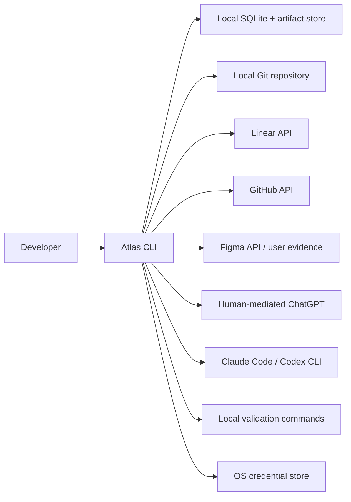

## 11. High-Level Architecture

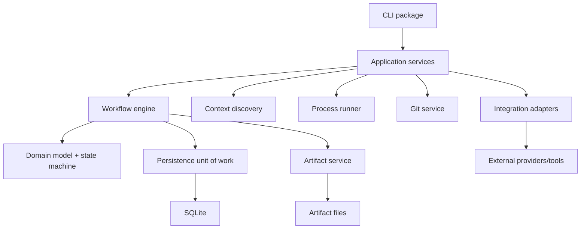

## 12. Runtime Architecture

Atlas runs as foreground CLI processes. Each invocation loads configuration, acquires a session/project lock when needed, reconciles state, executes one command, writes audit events, releases locks, and exits. Long-running agent/check commands remain owned child processes of that Atlas invocation; V1 has no daemon.

## 13. Module and Package Boundaries

Core modules: `domain`, `workflow`, `persistence`, `artifacts`, `config`, `security`, `diagnostics`, `schemas`.

Application modules: `cli`, `app-services`, `context`, `git`, `process-runner`, `checks`.

Adapter modules: `adapters-linear`, `adapters-github`, `adapters-figma`, `adapters-claude`, `adapters-codex`, `adapters-clipboard`, `adapters-opener`, `adapters-credentials`, `adapters-notifications`.

## 14. Component Responsibilities

| Component | Owns | Must not own |
| --- | --- | --- |
| CLI | Command parsing, prompts, output formatting, exit codes | Business rules |
| Workflow engine | Transitions, gates, invalidation, approvals | Provider-specific API logic |
| Domain | State enums, value objects, invariants | IO |
| Persistence | Transactions, migrations, locks, query repositories | Handoff Markdown content generation |
| Artifact service | Hashing, atomic file writes, metadata coordination | Workflow decisions |
| Context discovery | Candidate discovery, ranking, budgets, manifests | AI relevance |
| Process runner | Direct child processes, logs, cancellation | Interpretation of product completion |
| Git service | Safe Git facts and allowed non-destructive operations | Force/reset/merge/push |
| Adapters | External reads/invocations | Core state transitions |

## 15. Dependency Direction

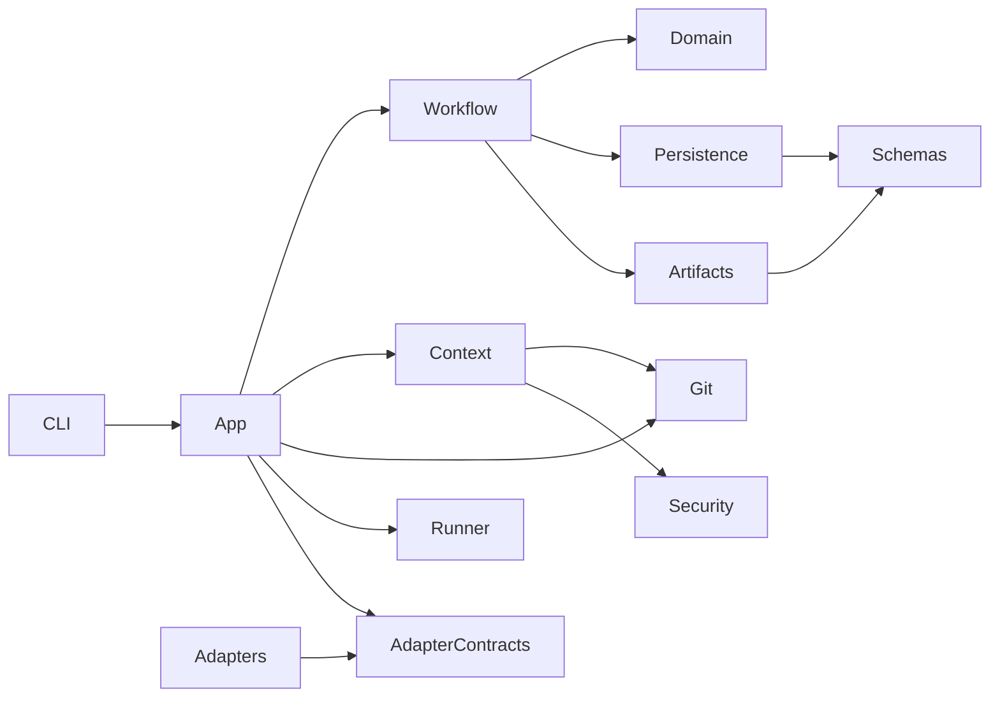

Dependencies point inward toward domain/contracts. Provider adapters depend on shared adapter contracts, never on workflow internals.

## 16. Process Model

- One foreground Atlas process per command.
- Session lock prevents concurrent mutation of the same session.
- Project lock prevents conflicting project config writes.
- Child processes are spawned with explicit executable and argument arrays.
- PTY is opt-in for agent adapters that require interactivity; checks default to non-PTY.
- Cancellation is cooperative, then terminates only owned child process trees.

## 17. Persistence Model

SQLite stores canonical workflow metadata, current state, approvals, events, run summaries, checks, findings, and artifact records. Artifact files store versioned Markdown/JSON/log payloads. Both are tied by SHA-256 and immutable artifact IDs. The M1 walking skeleton uses `sql.js` behind the persistence boundary to avoid experimental Node SQLite APIs and native build-tool requirements; the boundary remains narrow enough to swap drivers during release hardening if needed.

## 18. Session Model

A session has identity, source task, repository identity, primary workflow state, lifecycle overlays, current artifact pointers, git facts, gate statuses, and event history. One Linear issue or manual task maps to one session unless the user explicitly starts a new session.

## 19. State-Machine Design

The workflow state is a single primary dimension. Pause/archive/cancel are lifecycle overlays/dispositions:

- `paused`: reversible overlay blocking forward transitions.
- `archived`: reversible listing/storage overlay.
- `cancelled`: terminal disposition; inspect/export allowed, normal progression blocked.

Primary states are defined in `03_workflow_state_specification.md`.

## 20. Artifact Model

Artifacts are immutable versions with `artifact_id`, `type`, `schema_version`, `content_version`, `sha256`, `sensitivity`, `producer`, `parents`, `replaces`, and storage paths. Approved artifacts cannot be edited in place. New bytes create a new artifact version.

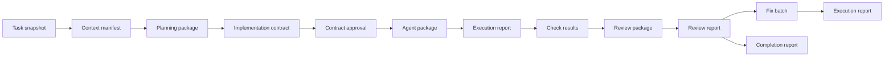

## 21. Event and Audit Model

Every state transition, approval, override, artifact creation/import, adapter call summary, run, check, finding disposition, reconciliation, and security-relevant config change writes an append-only audit event. Events store metadata and artifact references, not raw secrets or full source content.

## 22. Configuration Architecture

Precedence from low to high:

1. Built-in defaults.
2. User preferences.
3. Project config.
4. Local project overrides.
5. Session overrides.
6. Command flags.

Security-sensitive unknown fields are rejected. `atlas config explain <key>` reports value, source, and redaction.

## 23. Context-Discovery Architecture

Context discovery is deterministic and bounded: Git facts, task references, configured source roots, instruction files, changed/related files, GraphQL operations, tests, route/component patterns, and design-system docs are ranked by explicit heuristics. User pins outrank heuristics. Secret/vendor/generated exclusions apply before ranking.

## 24. Integration-Adapter Architecture

Adapters expose capabilities, version/availability checks, normalized request/response types, namespaced provider metadata, redacted errors, retry policies, and mock contracts. Provider metadata cannot leak into core state except through explicit `provider_metadata` objects.

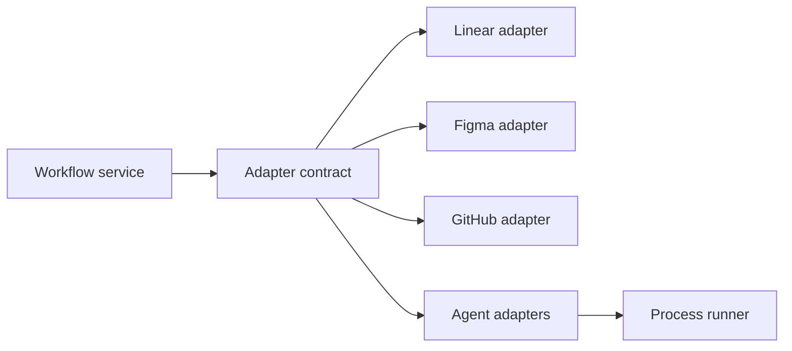

## 25. Coding-Agent Execution Architecture

Atlas generates an implementation or fix package from the approved contract, validates Git/context freshness, invokes the selected adapter, records process facts, captures logs, validates any completion report, and independently reconciles Git/check evidence. Process success, agent claim, Git changes, passing checks, and product completion are separate facts.

## 26. Local Command-Runner Architecture

Checks use configured executable and argument arrays, working directory, timeout, dependencies, affected-file rules, and redaction rules. Output is streamed in concise progress form and stored as redacted logs with hashes.

## 27. Git Integration and Safety Architecture

Allowed: read status, refs, remotes, branch identity, diff summaries, bounded patches, create/switch branch only through approved policy, and non-destructive fetch when explicitly configured.

Blocked in V1: reset, force checkout, force push, merge, rebase, branch deletion, stash, discard, automatic commit unless future explicit policy permits.

## 28. Approval and Override Model

Approval records link actor, artifact, hash, consequences, blockers, timestamp, command ID, and optional rationale. Overrides are separate records with gate ID, reason, expiry or scope, actor, and non-overrideable gate enforcement. Approvals and overrides are append-only.

## 29. Review and Fix-Loop Architecture

Review packages contain contract, diff, checks, run reports, deviations, and rubric. Imported review reports become findings. The developer dispositions findings before fix batches. Fix batches include only approved actionable findings tied to review iteration, contract hash, and Git head.

## 30. Resume and Recovery Architecture

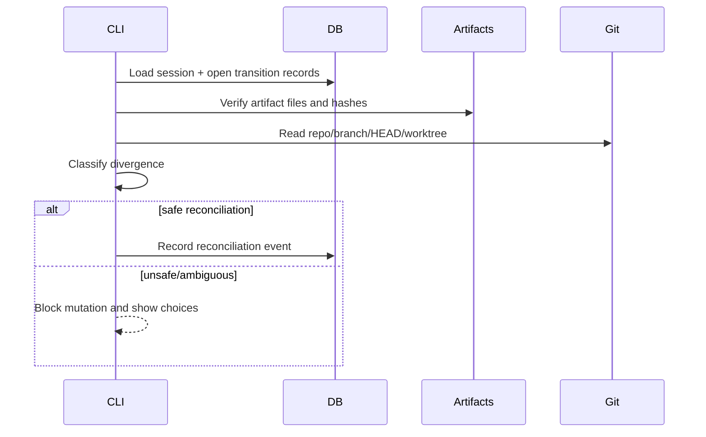

## 31. Concurrency and Locking Strategy

SQLite holds durable lock records with owner PID, hostname, process start time, command ID, acquired time, heartbeat, and expiry. File locks are used as advisory OS-level guards where supported. Stale lock breaking requires PID/process validation and event recording.

## 32. Error Taxonomy

`UsageError`, `ConfigError`, `ValidationError`, `StateTransitionError`, `ApprovalRequiredError`, `GateFailedError`, `AdapterUnavailableError`, `ProviderError`, `GitSafetyError`, `ProcessError`, `TimeoutError`, `CancellationError`, `SecurityPolicyError`, `PersistenceError`, `ArtifactIntegrityError`, `MigrationError`, `RecoveryRequiredError`, `InternalError`.

## 33. Exit-Code Strategy

| Code | Meaning |
| --- | --- |
| 0 | Success |
| 1 | General failure |
| 2 | Usage/argument error |
| 3 | Invalid configuration |
| 4 | Invalid transition or missing approval |
| 5 | Required gate failed |
| 6 | Adapter/provider unavailable |
| 7 | Git safety block |
| 8 | Validation/import error |
| 9 | Cancelled |
| 10 | Recovery required |
| 70 | Internal error |

## 34. Logging and Diagnostics

Console output is concise and redacted. Structured diagnostic events store command ID, session ID, durations, statuses, gate IDs, and artifact references. V1 also includes product telemetry and analysis events for workflow health and product learning. Source content, prompts, diffs, filenames, repository URLs, raw issue/design text, and secrets are excluded from telemetry. Diagnostic bundles require preview.

## 35. Security Architecture

Security controls include keychain credential aliases, redaction pipeline, path canonicalization, symlink checks, direct process execution, blocklisted destructive Git operations, config allowlists, untrusted-content treatment, artifact sensitivity labels, user-only permissions, and dependency/release scanning.

## 36. Privacy Model

Atlas is local-first. Remote transfers occur only through configured adapters, product telemetry configured under the approved telemetry policy, or manual developer action. Product telemetry is privacy-preserving and content-free: it may include event categories, timings, counts, statuses, adapter capability outcomes, and anonymized/coarsened environment facts, but never source code, prompts, diffs, secrets, filenames, repository URLs, raw issue text, raw design text, or artifact content. Session export and diagnostics carry sensitivity labels and preview manifests.

## 37. Threat Model

The detailed threat model is in `09_security_threat_model.md`. Trust boundaries: user, Atlas core, repository, imported artifacts, coding agents, SaaS integrations, OS, and external model services.

## 38. Testing Architecture

Tests are layered: unit, schema, state machine, property-based, migration, crash injection, filesystem failure, adapter contract, mock provider, real-provider smoke, Git fixtures, process cancellation/timeout, redaction, context budgets, CLI snapshots, JSON contracts, E2E, and release acceptance.

## 39. Cross-Platform Strategy

Use Node APIs and direct process spawning; avoid shell-specific behavior. Normalize paths internally while preserving display paths. Validate on Windows PowerShell/Git, macOS shells, and Ubuntu. Use OS-specific keychain adapters behind the same interface.

## 40. Packaging and Distribution

Recommended package manager is `pnpm`; publish as an npm CLI package with `bin` entry, lockfile, provenance where available, signed/checksummed release artifacts, and CI matrix. The M1 persistence driver is `sql.js`; any future native SQLite/keychain dependencies must be validated before commitment.

## 41. Upgrade and Migration Strategy

SQLite migrations are versioned and transactional. Before migration, Atlas writes a backup copy of the DB and records artifact hashes. Failed migration restores prior usable state. Artifact schema upgrades create new versions; approved artifact bytes are never rewritten.

## 42. Performance Considerations

Startup reads cached status first. Context discovery is incremental, Git-aware, and budgeted. Long operations emit progress within 2 seconds and at least every 10 seconds. Logs and diff content are bounded with explicit omissions.

## 43. Operational Limits

Defaults: no whole-repo ingestion, ignored/vendor/generated paths excluded, large/binary files omitted, artifact size budgets enforced, provider retries bounded, no background daemon, single-machine sessions, no transparent cross-machine sync.

## 44. Alternatives Considered

- Full event sourcing: stronger replay, higher complexity; rejected for V1.
- Cloud coordination: collaboration benefits, violates local-first V1; deferred.
- Browser automation for ChatGPT: smoother UX, unsupported/security risk; rejected.
- Git as sole state store: portable but weak querying/recovery; rejected.
- Filesystem-only metadata: simple but poor transactions; rejected.

## 45. Trade-Offs

SQLite plus immutable files adds reconciliation complexity but gives durable queries and portable artifacts. Human-mediated ChatGPT leaves copy work but is honest and subscription-compatible. Strict gates add ceremony but prevent intent drift and false readiness.

## 46. Remaining Open Questions

| ID | Approved decision | Human approval before full M1? |
| --- | --- | --- |
| OQ-001 Node/OS versions | Node 22 LTS; latest supported Windows, latest macOS, Ubuntu LTS | Approved |
| OQ-002 Project config commit default | Commit `atlas.config.json`; keep `atlas.local.json` ignored | Approved |
| OQ-003 Data layout | User data directory canonical; optional project `.atlas/artifacts` link | Approved |
| OQ-004 Contract structure | Markdown with fenced JSON metadata block plus required headings | Approved |
| OQ-005 Agent versions | Publish tested matrix; manual export fallback | Approved |
| OQ-006 Agent commits | Default no; explicit future policy only | Approved |
| OQ-007 GitHub PR creation | Not required for V1 | Follows PRD default |
| OQ-008 UI token rules | Project-configured deterministic rules | Approved |
| OQ-009 Visual evidence | User-supplied files/links plus optional screenshot command | Approved |
| OQ-010 Artifact location | Canonical outside Git; project-local optional ignored mirror | Approved |
| OQ-011 Material change | Scope, architecture, data/security, design, acceptance, tests | Approved |
| OQ-012 Telemetry | V1 includes privacy-preserving product telemetry and analysis, with content exclusions and disable controls | Approved with amendment |

## 47. Implementation Sequencing

Sequence: foundations and schemas, persistence/artifacts, state machine, CLI/config, walking skeleton, Git safety, checks, context discovery, manual handoffs, agent adapters, Linear/Figma/GitHub reads, recovery hardening, release packaging.

## 48. Definition of Architecture-Ready

M0 is architecture-ready when reviewers approve:

- Primary state model and lifecycle overlays.
- SQLite/artifact authority split.
- Adapter contracts and security boundaries.
- Git/process safety rules.
- Data layout and migration/backup plan.
- Walking-skeleton scope and first ticket.
- The M0 review decisions recorded in `M0_Review_Decisions.md`.

## Required Sequences

### End-to-End Sequence

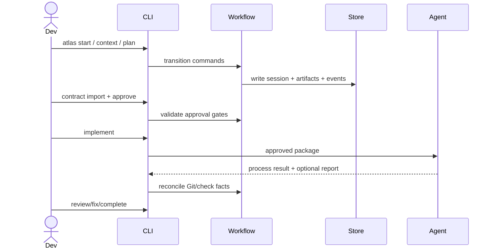

### Contract Approval Sequence

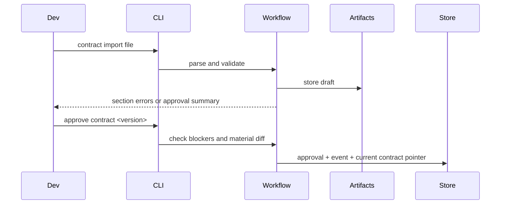

### Coding-Agent Execution Sequence

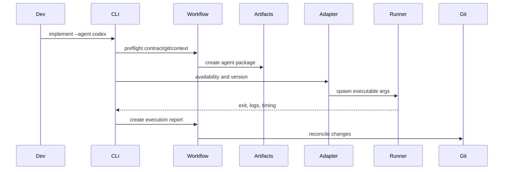

### Review and Fix Loop Sequence

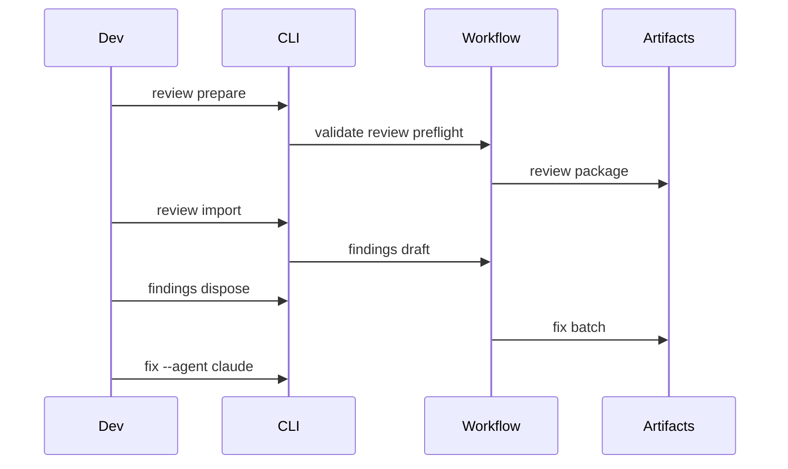

### Session Lifecycle

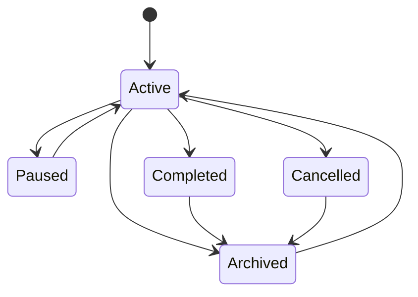

### Failure Recovery Flow

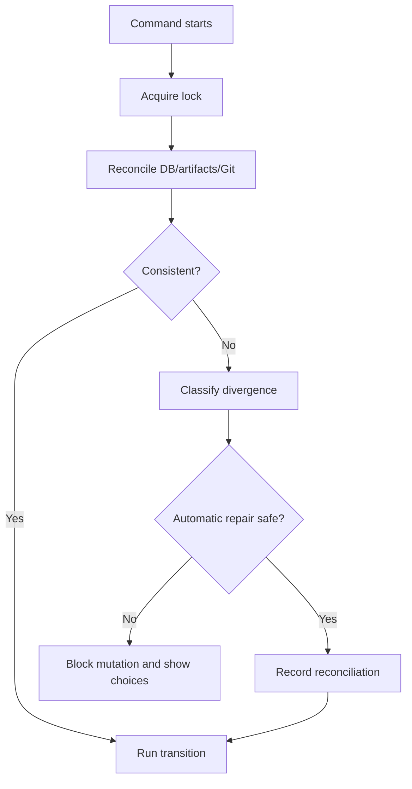

### Security Boundary Diagram

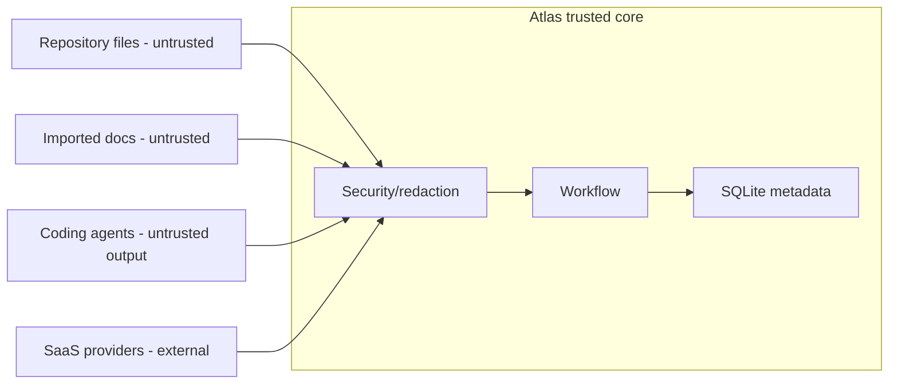
