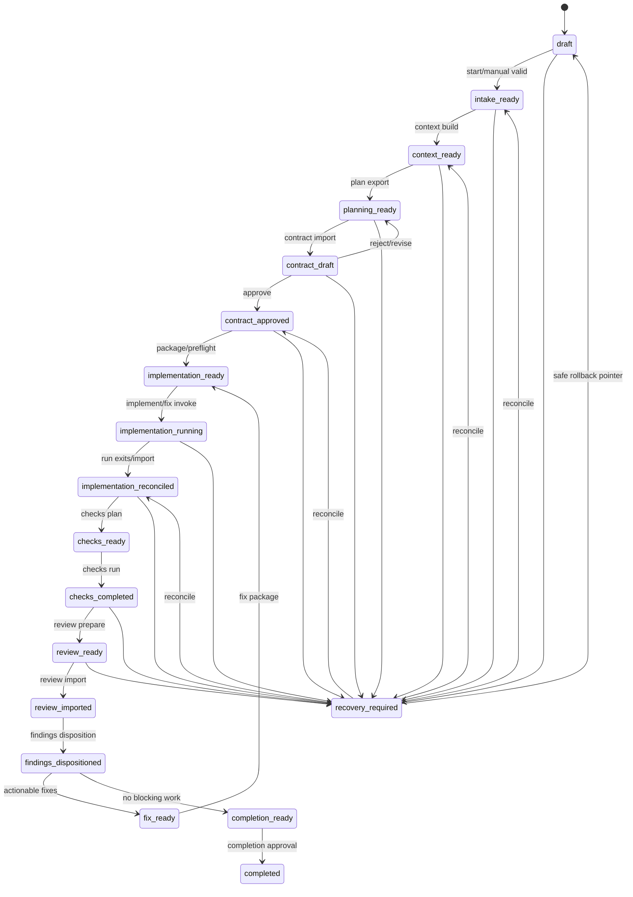

# Deliverable C: Normative Workflow-State Specification

## Decision: Primary State Plus Lifecycle Overlays

Atlas uses one primary workflow-state dimension and separate lifecycle overlays.

- Primary workflow state answers: "What work stage is this task in?"
- Lifecycle overlay answers: "May this session progress or appear in active lists?"
- Terminal disposition answers: "Has coordination ended?"

Recommended model:

| Concept | Model | Justification |
| --- | --- | --- |
| Pause | Reversible overlay `paused=true` | It preserves current workflow state and blocks forward transitions. |
| Archive | Reversible overlay `archived=true` | It affects listing/retention, not technical workflow completeness. |
| Cancel | Terminal disposition `disposition=cancelled` | It intentionally prevents normal progression without deleting work. |
| Abandon | Alias of cancelled with reason `abandoned` | Avoids duplicate terminal semantics. |
| Complete | Terminal primary state plus completion approval | Completion is a workflow outcome, not just an overlay. |

## Primary Workflow States

| State ID | Meaning | Required current evidence |
| --- | --- | --- |
| `draft` | Session shell exists but intake is incomplete or invalid. | Draft task input. |
| `intake_ready` | Task source is normalized and repository identity is known. | Task brief, repo snapshot. |
| `context_ready` | Current context manifest exists, with gaps/staleness classified. | Context manifest. |
| `planning_ready` | Planning package exists and is suitable for human-mediated planning. | Planning package. |
| `contract_draft` | A contract draft was imported but is not approved. | Contract draft artifact. |
| `contract_approved` | A valid immutable contract version is approved. | Contract approval. |
| `implementation_ready` | Agent/manual implementation package exists and Git preflight is valid. | Agent package, Git snapshot. |
| `implementation_running` | Atlas owns or just launched an execution run. | Execution run record. |
| `implementation_reconciled` | Run ended or was imported and Git facts were reconciled. | Execution report, Git snapshot. |
| `checks_ready` | Required checks are configured and can run against current Git facts. | Check plan. |
| `checks_completed` | Check run set is complete for the current Git fingerprint. | Check results. |
| `review_ready` | Review package exists for current contract/diff/check facts. | Review package. |
| `review_imported` | Review report imported and findings parsed. | Review report and findings. |
| `findings_dispositioned` | Developer has dispositioned imported findings. | Finding dispositions. |
| `fix_ready` | Fix batch exists for approved actionable findings. | Fix batch. |
| `completion_ready` | Completion gates evaluate pass or permitted overrides. | Gate evaluation. |
| `completed` | Developer approved completion. | Completion approval/report. |
| `recovery_required` | Atlas cannot safely continue without reconciliation choice. | Recovery issue event. |

## Normative State Diagram



## Transition Matrix

| Transition | From | To | Trigger | Preconditions | Guard conditions | Required artifacts/approvals | Side effects | Invalidates | Retry/idempotency | Failure/recovery | Reversible |
| --- | --- | --- | --- | --- | --- | --- | --- | --- | --- | --- | --- |
| `create_manual_session` | none/draft | intake_ready | `atlas start --manual` | Valid title/objective/repo | Repo identity readable | Manual task input | Session, event, task brief | None | Same idempotency key resumes draft | draft/recovery_required | Yes before approval |
| `create_linear_session` | none/draft | intake_ready | `atlas start ENG-1` | Linear adapter configured | Fetch successful or manual fallback chosen | Linear snapshot | Session, task brief, references | None | Provider reads retryable | no misleading complete session | Yes |
| `build_context` | intake_ready/context_ready | context_ready | `atlas context build/refresh` | Repo verified | Budgets honored or overflow classified | Context manifest | Source records, gaps | Plan/package descendants if changed | Deterministic for same inputs | partial manifest or recovery_required | Yes by rebuilding |
| `export_plan` | context_ready/planning_ready | planning_ready | `atlas plan` | Context not stale or override | Required gaps resolved | Planning package | Markdown/JSON artifact, clipboard optional | Prior plan if inputs changed | Idempotent same fingerprints | planning_ready with copy failure | Yes |
| `import_contract` | planning_ready/contract_draft | contract_draft | `atlas contract import` | Input file/stdin exists | Schema parse attempted | Contract draft | Draft artifact, validation result | Prior draft only | Same content same hash | draft rejected with errors | Yes |
| `approve_contract` | contract_draft | contract_approved | `atlas approve contract` | Valid required sections | No blocking questions; material diff acknowledged | Explicit approval | Approval record, event | Agent/check/review/completion tied to older contract | Not duplicated if same actor/artifact/idempotency key | blocked with errors | No; supersede only |
| `prepare_implementation` | contract_approved/fix_ready | implementation_ready | `atlas implement --prepare` or `fix` | Contract approved | Git safe, context fresh | Agent/fix package | Package artifact, Git snapshot | Older package if facts changed | Deterministic | GitSafetyError/recovery_required | Yes |
| `invoke_agent` | implementation_ready | implementation_running | `atlas implement --agent` | Adapter available | User confirms scope; lock held | Agent package | Execution run queued/running | None | Retry creates new run unless prior queued same key | failed/interrupted | Cancel only |
| `import_execution_result` | implementation_running/implementation_ready | implementation_reconciled | run exit/import | Run record or simulated result | Git reconciled | Execution report | Run status, git facts | Checks/review if HEAD changed | Import same report is idempotent | recovery_required if ambiguous | No; supersede |
| `plan_checks` | implementation_reconciled/checks_ready | checks_ready | `atlas checks --plan` | Work exists | Config valid | Check plan | Plan artifact | Prior check plan if config changed | Idempotent | ConfigError | Yes |
| `run_checks` | checks_ready/checks_completed | checks_completed | `atlas checks` | Check plan | Required commands safe | Check results | Runs/logs/results | Review/completion if Git/config changed | Rerun creates new set; same facts comparable | failed check state, not workflow failure | Yes by rerun |
| `prepare_review` | checks_completed/review_ready | review_ready | `atlas review prepare` | Approved contract; diff available | Required checks pass or override | Review package | Package artifact | Prior review if inputs changed | Idempotent same inputs | draft package if blocked | Yes |
| `import_review` | review_ready/review_imported | review_imported | `atlas review import` | Review package exists | Hash/context matches or stale draft | Review report | Findings records | Prior undispositioned findings superseded only by approval | Same content idempotent | draft/malformed review | Yes |
| `dispose_findings` | review_imported/findings_dispositioned | findings_dispositioned | `atlas findings disposition` | Findings exist | Blocking dispositions valid | Disposition records | Finding status updates | Fix batches if changed | Idempotent per finding disposition version | blocked if incomplete | Yes by new disposition |
| `create_fix_batch` | findings_dispositioned | fix_ready | `atlas fix prepare` | Approved actionable findings | Git/contract unchanged | Fix batch | Fix artifact | Older stale fix batch | Idempotent same findings/head | blocked if stale | Yes |
| `evaluate_completion` | findings_dispositioned/checks_completed | completion_ready | `atlas complete --check` | Current contract/checks/findings | Non-overrideable gates pass | Gate evaluation | Completion draft | Older completion if facts changed | Idempotent | blocked with gate list | Yes |
| `approve_completion` | completion_ready | completed | `atlas approve completion` | Gate eval current | User approval; allowed overrides recorded | Completion report/approval | Terminal completion event | None | Not duplicated | blocked if stale | No |
| `pause` | any nonterminal | same + paused | `atlas pause` | Session exists | Owned run cancelled/interrupted first | Pause event | Overlay set | None | Idempotent | recovery_required if run unknown | Yes |
| `resume_pause` | same + paused | same - paused | `atlas resume` | Session exists | Reconciliation complete | Resume event | Overlay cleared | Stale descendants as needed | Idempotent | recovery_required | Yes |
| `archive` | any | same + archived | `atlas archive` | Session exists | Confirmation | Archive event | Overlay set | None | Idempotent | None | Yes |
| `cancel` | any nonterminal | disposition cancelled | `atlas cancel` | Session exists | Confirmation + reason | Cancel event | Terminal disposition | Normal progression | Idempotent | None | No normal reversal; can clone |

## Transition Pseudocode

```ts
function executeTransition(command, sessionId, input) {
  const lock = locks.acquire(sessionId, command.id);
  try {
    const session = reconcileOrThrow(sessionId);
    assertNotArchivedUnlessAllowed(session, command);
    assertNotPausedUnlessAllowed(session, command);
    assertNotCancelledUnlessAllowed(session, command);
    const spec = transitionTable.lookup(session.primaryState, command.type);
    validateInput(spec.inputSchema, input);
    const facts = collectPreflightFacts(spec, session, input);
    const gateResult = evaluateGuards(spec.guards, session, facts);
    if (!gateResult.pass) throw new GateFailedError(gateResult);
    const stagedArtifacts = artifactService.stage(spec.produceArtifacts(session, facts));
    persistence.transaction(tx => {
      const promotedRefs = artifactService.reserve(tx, stagedArtifacts);
      spec.applyDbChanges(tx, session, facts, promotedRefs);
      tx.events.append(spec.auditEvent(session, facts, promotedRefs));
    });
    artifactService.promote(stagedArtifacts);
    return statusView(sessionId);
  } catch (error) {
    recovery.classifyAndRecord(sessionId, command, error);
    throw error;
  } finally {
    lock.release();
  }
}
```

## Invalid-Transition Examples

| Example | Result |
| --- | --- |
| `atlas implement` from `planning_ready` | `ApprovalRequiredError`: no approved contract. |
| `atlas approve contract` with missing required section | `ValidationError`: draft retained, approval blocked. |
| `atlas review prepare` after HEAD changed since checks | `GateFailedError`: checks stale; rerun or permitted override. |
| `atlas complete` with unresolved blocking finding | `GateFailedError`: completion blocked. |
| `atlas fix` with rejected suggestions only | `StateTransitionError`: no approved actionable findings. |
| Any forward transition while paused | `StateTransitionError`: resume first. |
| Any normal transition after cancelled | `StateTransitionError`: cancelled sessions are inspect/export only. |

## Crash-Recovery Examples

| Crash point | Recovery behavior |
| --- | --- |
| After artifact staging before DB transaction | Delete orphan staging files after hash verification; state unchanged. |
| After DB commit before artifact promotion | Promote staged file if hash exists; otherwise mark `recovery_required`. |
| During child process | Run becomes `interrupted` unless adapter can prove completed status; Git facts are reconciled. |
| During migration | Restore backup and retain failed migration diagnostic. |
| During approval write | Either approval record and event exist or no approval exists; never infer approval from artifact text. |
