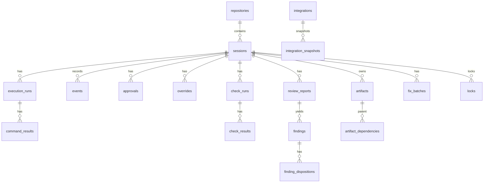
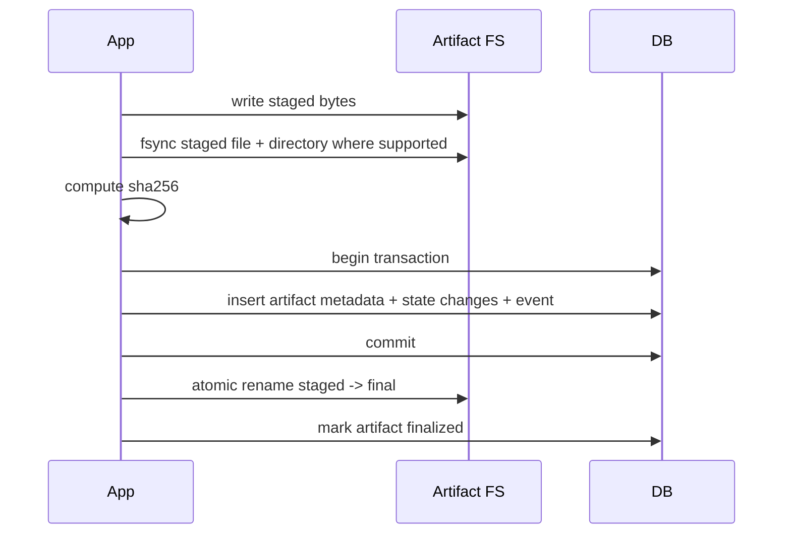

# Deliverable D: Persistence and Data Design

## Authority Decisions

- SQLite is authoritative for workflow metadata, current pointers, approvals, gates, events, run summaries, findings, locks, and migrations.
- Artifact files are authoritative for immutable artifact bytes.
- The initial implementation uses `sql.js` behind the persistence boundary. SQLite remains the data model; driver-specific file export/import mechanics are not exposed to workflow code.
- Database rows reference artifact bytes by `artifact_id`, `storage_uri`, `sha256`, `byte_length`, `schema_version`, and `content_version`.
- Hashes are SHA-256 over canonical UTF-8 bytes for text artifacts and raw bytes for binary evidence. JSON artifacts use canonical key ordering before hashing.
- Partial writes are prevented with staging directories, atomic rename, DB transactions, and recovery journals.

## Data Layout

Recommended default:

```text
<userData>/sigil/
  sigil.db
  artifacts/
    <repo_hash>/<session_id>/<artifact_type>/<version>-<sha256-prefix>.md
    <repo_hash>/<session_id>/<artifact_type>/<version>-<sha256-prefix>.json
  logs/
    <repo_hash>/<session_id>/<run_id>.log
  backups/
  tmp/
```

Project config:

```text
<repo>/sigil.config.json
<repo>/sigil.local.json
<repo>/.sigil/            # optional gitignored mirror or links only
```

## Entity-Relationship Diagram



## SQLite Tables

### `schema_migrations`

| Column | Type | Constraints |
| --- | --- | --- |
| `version` | integer | primary key |
| `name` | text | not null |
| `applied_at` | text | ISO timestamp |
| `checksum` | text | not null |
| `status` | text | check in `applied,rolled_back,failed` |

Purpose: track applied migrations. Indexes: primary key only.

### `repositories`

| Column | Type | Constraints |
| --- | --- | --- |
| `repo_id` | text | primary key; stable hash |
| `root_path` | text | not null |
| `remote_url_hash` | text | nullable |
| `display_name` | text | not null |
| `created_at`, `updated_at` | text | not null |

Indexes: `idx_repositories_root_path`.

### `sessions`

| Column | Type | Constraints |
| --- | --- | --- |
| `session_id` | text | primary key |
| `repo_id` | text | fk `repositories(repo_id)` |
| `task_key` | text | nullable |
| `task_source` | text | check `linear,manual` |
| `primary_state` | text | not null |
| `paused` | integer | boolean check 0/1 |
| `archived` | integer | boolean check 0/1 |
| `disposition` | text | nullable check `cancelled,completed` |
| `current_contract_artifact_id` | text | fk artifacts nullable |
| `current_context_artifact_id` | text | fk artifacts nullable |
| `current_git_head` | text | nullable |
| `created_at`, `updated_at`, `closed_at` | text | nullable as appropriate |

Unique: `(repo_id, task_source, task_key)` where task_key not null and disposition not cancelled. Indexes: state, repo.

### `artifacts`

| Column | Type | Constraints |
| --- | --- | --- |
| `artifact_id` | text | primary key |
| `session_id` | text | fk sessions |
| `type` | text | not null |
| `schema_version` | integer | not null |
| `content_version` | integer | not null |
| `storage_uri` | text | not null |
| `sha256` | text | not null |
| `byte_length` | integer | not null check >= 0 |
| `media_type` | text | e.g. text/markdown, application/json |
| `sensitivity` | text | check `public,internal,confidential,secret-redacted` |
| `status` | text | check `draft,valid,rejected,approved,superseded,stale` |
| `producer_type` | text | check `sigil,user,adapter,agent,import` |
| `producer_id` | text | nullable |
| `created_at` | text | not null |
| `approved_at` | text | nullable |

Unique: `(session_id,type,content_version)`, `(sha256,type)`. Indexes: session/type/status.

### `artifact_dependencies`

| Column | Type | Constraints |
| --- | --- | --- |
| `artifact_id` | text | fk artifacts |
| `depends_on_artifact_id` | text | fk artifacts |
| `dependency_kind` | text | e.g. `input,parent,replaces,evidence` |

Primary key: `(artifact_id, depends_on_artifact_id, dependency_kind)`.

### `events`

| Column | Type | Constraints |
| --- | --- | --- |
| `event_id` | text | primary key |
| `session_id` | text | fk sessions nullable for global events |
| `event_type` | text | not null |
| `actor_type` | text | `user,sigil,adapter,agent` |
| `actor_id` | text | nullable |
| `command_id` | text | nullable |
| `occurred_at` | text | not null |
| `summary` | text | not null |
| `metadata_json` | text | canonical redacted JSON |

Indexes: session/time, event_type.

### `approvals`

| Column | Type | Constraints |
| --- | --- | --- |
| `approval_id` | text | primary key |
| `session_id` | text | fk sessions |
| `artifact_id` | text | fk artifacts |
| `approval_type` | text | `contract,completion,override_disposition` |
| `artifact_sha256` | text | not null |
| `actor_id` | text | not null |
| `rationale` | text | nullable |
| `created_at` | text | not null |
| `revoked_by_id` | text | nullable; supersession only |

Unique: `(artifact_id, approval_type, actor_id, created_at)`.

### `overrides`

| Column | Type | Constraints |
| --- | --- | --- |
| `override_id` | text | primary key |
| `session_id` | text | fk sessions |
| `gate_id` | text | not null |
| `scope` | text | `review,completion,check` |
| `reason` | text | not null |
| `actor_id` | text | not null |
| `expires_at` | text | nullable |
| `created_at` | text | not null |

Indexes: session/gate/scope.

### `execution_runs`

| Column | Type | Constraints |
| --- | --- | --- |
| `run_id` | text | primary key |
| `session_id` | text | fk sessions |
| `agent_kind` | text | `manual,claude,codex` |
| `adapter_version` | text | nullable |
| `contract_artifact_id` | text | fk artifacts |
| `package_artifact_id` | text | fk artifacts |
| `status` | text | `queued,running,succeeded,failed,cancelled,interrupted,unknown` |
| `pid` | integer | nullable |
| `started_at`, `ended_at` | text | nullable |
| `base_sha`, `head_before`, `head_after` | text | nullable |
| `log_artifact_id` | text | fk artifacts nullable |
| `report_artifact_id` | text | fk artifacts nullable |

Indexes: session/status/time.

### `command_results`

| Column | Type | Constraints |
| --- | --- | --- |
| `command_result_id` | text | primary key |
| `session_id` | text | fk sessions |
| `run_id` | text | fk execution_runs nullable |
| `command_kind` | text | `agent,check,git,adapter` |
| `executable` | text | redacted display |
| `args_json` | text | redacted JSON |
| `cwd` | text | canonical path |
| `exit_code` | integer | nullable |
| `normalized_status` | text | `succeeded,failed,cancelled,timeout,interrupted` |
| `duration_ms` | integer | nullable |
| `stdout_log_artifact_id`, `stderr_log_artifact_id` | text | fk artifacts nullable |
| `created_at` | text | not null |

### `check_definitions`

| Column | Type | Constraints |
| --- | --- | --- |
| `check_id` | text | primary key |
| `repo_id` | text | fk repositories |
| `name` | text | not null |
| `config_version` | text | not null |
| `definition_json` | text | canonical config |
| `required` | integer | boolean |

Unique: `(repo_id,name,config_version)`.

### `check_runs` and `check_results`

`check_runs`: run set ID, session, git fingerprint, config version, status, started/ended timestamps.

`check_results`: result ID, check run ID, check definition ID, command result ID, status `passed,failed,skipped,blocked,cancelled,timeout`, duration, log artifacts, failure summary.

### `review_reports`, `findings`, `finding_dispositions`, `fix_batches`

Review tables link review package artifact, imported report artifact, iteration, contract hash, and Git fingerprint. Findings store severity, status, evidence references, affected files, requirement IDs, and suggested action. Dispositions are append-only with actor, reason, resolution evidence. Fix batches link approved findings, contract, HEAD, and package artifact.

### `integration_snapshots`

Stores normalized read snapshots from Linear, GitHub, Figma, and credential capability checks. Columns: snapshot ID, provider, provider object ID, session ID, fetched_at, expires_at, status, normalized JSON artifact ID, provider metadata JSON.

### `project_memory_records`

Stores confirmed reusable repo rules, commands, design mappings, instruction paths, freshness fingerprints, and source artifact IDs. Soft deletion via `status=inactive`.

### `user_preferences`

Key/value records for non-secret local preferences. Values are redacted if displayed by `config explain`.

### `locks`

| Column | Type | Constraints |
| --- | --- | --- |
| `lock_id` | text | primary key |
| `scope` | text | `session,project,global` |
| `scope_id` | text | not null |
| `owner_pid` | integer | not null |
| `owner_hostname` | text | not null |
| `owner_command_id` | text | not null |
| `acquired_at`, `heartbeat_at`, `expires_at` | text | not null |

Unique active lock by `(scope, scope_id)`.

## Write Protocol



If final rename fails after commit, `resume` promotes matching staged content or marks `recovery_required`.

## Consistency Repair

| Condition | Detection | Repair |
| --- | --- | --- |
| DB artifact row missing file | Hash check fails | If staged file with same hash exists, promote; else mark artifact missing and block dependent gates. |
| Orphan artifact file | FS scan not referenced | Leave untouched; doctor can quarantine after preview. |
| Hash mismatch | Recompute hash | Mark artifact tampered; block approval/completion. |
| Missing DB event | Invariant check | Repair only if state metadata is otherwise complete; record synthetic repair event. |
| Corrupt SQLite | Open/integrity check fails | Restore latest backup after preview; never fabricate approvals. |

## External File Deletion and Corruption

External deletion is detected by artifact hash verification on `status`, `resume`, and before dependent transitions. Approved contract deletion is non-overrideable for implementation/completion until restored from backup or re-imported and reapproved.

## Backup and Restore

- Before migrations: copy DB to `backups/<timestamp>-pre-migration.db`.
- Before repair: write repair plan artifact.
- Artifact backups rely on immutable files plus session export; optional compressed session export includes manifest and hashes.
- Restore verifies DB integrity, migration version, artifact hashes, and repository identity before activation.

## Migration Rollback

Migrations are forward-only in normal operation. If an apply fails, Sigil restores the pre-migration backup and records a failed migration diagnostic. Approved artifact bytes are never rewritten by migration.

## Retention, Soft Deletion, and Archival

V1 supports archive, not destructive deletion, by default. Retention policy can compact logs and derived draft packages after preview but must preserve approved contracts, approvals, completion records, and audit events unless explicit future deletion policy is approved.
