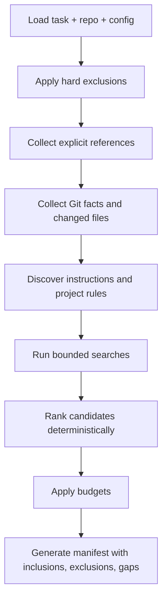

# Deliverable G: Context-Discovery Technical Design

## Objective

Build a bounded, traceable context manifest without whole-repo ingestion or undefined AI relevance. The output is deterministic for identical task, repository, config, and Git inputs.

Implementation note: the production v3 schema, TypeScript semantic graph, instruction precedence, safety rules, and freshness gates are normative in `16_context_manifest_v3_semantic_discovery.md`. This earlier design remains useful for planned framework-specific discovery that v3 does not yet claim.

## Source Classes

| Class | Discovery method | Default priority |
| --- | --- | --- |
| Explicit task references | Parse Linear/manual text for URLs, file paths, symbols | 100 |
| User pins | `atlas context add/pin` | 100 |
| Changed files | Git diff from base/HEAD/worktree | 90 |
| Directory instructions | Configured instruction filenames along target paths | 85 |
| Project rules/design docs | Configured paths and conventional names | 80 |
| Tests near changed/target files | Naming and directory heuristics | 75 |
| GraphQL operations | Search operation names/imports/fragments | 70 |
| Routes/components | Framework-specific path and import heuristics | 65 |
| Redux/state patterns | Store slices/selectors/actions matching terms | 60 |
| Text/symbol search | Bounded `rg`/index search by task terms | 50 |
| External metadata | Figma/GitHub/Linear snapshots | 45 |
| User-supplied visual evidence | Explicit attach/import | 90 |

## Discovery Pipeline



## Git-Aware Discovery

- Resolve repo root, base branch/ref, current branch, HEAD, and worktree state.
- Changed-file discovery uses configured base plus uncommitted state when requested.
- External HEAD changes invalidate context only for dependent file/git sources.
- Submodules, nested repos, detached HEAD, and worktrees are recorded as facts; state-changing steps may block until acknowledged.

## Symbol and Text Search

Use `rg` when available; otherwise fallback to Node filesystem search with strict limits. Search terms come from task title/objective, known route names, component names, GraphQL operation names, issue labels, and user-specified terms. Results are capped per term and per directory.

Deterministic fallback: if ranking ties, sort by explicitness, path depth, path lexicographic order, then byte size ascending.

## Route and Component Discovery

Framework profiles are configuration-driven. For Next.js/React:

- routes: `app/**/page.tsx`, `app/**/layout.tsx`, `pages/**`, route groups.
- components: import graph from changed/explicit files, nearby `components/`, design-system imports.
- hooks/utilities: imports from explicit files and paths matching task terms.

Atlas records profile assumptions in the manifest and does not infer runtime behavior without evidence.

## GraphQL Discovery

- Parse `.graphql`, `gql` template literals, generated operation names, fragments, and typed hooks.
- Link operation files to tests and components by import graph or operation name.
- Generated GraphQL outputs are excluded by default unless needed as type references and within budget.

## Redux/State Discovery

- Search configured store roots for slices, selectors, actions, thunks, and RTK Query endpoints matching task terms.
- Include nearby tests and usage sites only when they fit budgets.
- If state management pattern is unclear, record a planning gap.

## Test Discovery

Candidate tests include files matching target basename, route/component names, operation names, and configured test directories. Existing failing/skipped test metadata is not inferred without running checks.

## Design-System Documentation Discovery

Configured docs and token/component registries outrank generic UI examples. Component mappings from contract or project memory are recorded as required sources.

## Agent-Instruction Discovery and Precedence

Instruction files are configured by name and scope. Recommended defaults:

1. Repository root instructions.
2. Directory-scoped instructions from root to target path.
3. Package/module-specific instructions.
4. Session/user pins.

Conflicts are surfaced as blocking planning gaps when material. Repository instructions cannot alter Atlas security policy.

## Include and Exclude Rules

Hard exclusions run before ranking:

- `.git`, dependency/vendor dirs (`node_modules`, `.next`, `dist`, `build`, coverage).
- generated files unless explicitly configured.
- binary files, large files above per-source limit.
- secrets and credentials: `.env*`, private keys, token stores, certificate/key material.
- files outside repo root unless explicitly user-attached and safe.

Soft exclusions are reported in manifest and may be overridden by user pin if security policy allows.

## Budgets

| Budget | Default recommendation |
| --- | --- |
| Global files | 80 |
| Global bytes | 400 KB Markdown package body |
| Per text source | 40 KB |
| Per source excerpt | 8 KB unless full file is required |
| Search time | 30 seconds total initial target |
| First progress | within 2 seconds |
| External metadata TTL | 24 hours unless provider/config says otherwise |

Oversize behavior: include summaries/metadata and references; never silently truncate critical constraints. Critical required sources over budget block readiness or require narrowing/override.

## Ranking Formula

```text
score =
  explicit_reference * 100 +
  user_pin * 100 +
  changed_file * 90 +
  instruction_applicability * 85 +
  configured_required_source * 80 +
  import_graph_distance_score +
  term_match_score +
  test_proximity_score -
  size_penalty -
  generated_penalty
```

No randomization. All included and excluded candidates record score inputs.

## Caching and Fingerprinting

Cache source metadata by repo ID, path, size, mtime, Git object ID where available, and SHA-256 when read. External snapshots include provider object ID, fetched_at, TTL, and adapter version. Cache misses or stale cache entries refresh only affected sources.

## Partial Results and Timeouts

Timeouts return partial manifests with `freshness=partial`, completed candidate classes, skipped classes, and retry guidance. A partial manifest may support planning only when required source classes are present or explicitly waived.

## Manifest Generation

The manifest includes:

- repository facts and Git fingerprint;
- task references and normalized external refs;
- included sources with reason, score, hash, size, sensitivity, freshness;
- exclusions with reason;
- gaps and blocking questions;
- budget usage;
- cache/freshness metadata;
- dependency edges to task/Linear/Figma/GitHub snapshots.

## User Pins and Exclusions

Pins and exclusions are session metadata with reason, actor, timestamp, and safety classification. Pins cannot include hard-secret files unless future explicit safe policy allows and redaction preview passes.

## Dependency Invalidation

| Changed input | Invalidates |
| --- | --- |
| Task brief | Context manifest, plan, contract drafts needing task fields |
| Source hash | Manifest, planning package, agent/review packages depending on it |
| Contract approval | Agent package, review package, completion readiness |
| Git HEAD/worktree | Checks, review package, execution report freshness |
| Check config | Check results, review/completion gates |
| Figma metadata TTL expired | Manifest freshness and plan/review labels |
