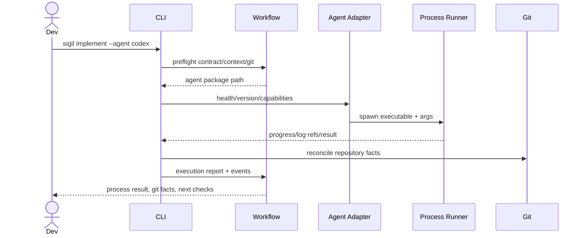

# Deliverable H: Process-Runner and Coding-Agent Design

## Non-Equivalence Rule

Sigil must always distinguish these facts:

| Fact | Meaning | Source |
| --- | --- | --- |
| Process completed successfully | Child process exited 0 or manual result imported | Process runner/import |
| Agent claims implementation complete | Agent report says done | Agent output |
| Git changes exist | Repository diff/commits changed | Git adapter |
| Required checks pass | Configured checks passed for current fingerprint | Check runner |
| Product completion approved | Developer approved completion gates | Workflow approval |

No single fact implies another.

## Executable Discovery and Version Checking

- Resolve configured executable path or search PATH.
- Run provider-specific version command with timeout.
- Compare against supported matrix.
- Store executable path hash/display path, version, checked_at, and capabilities.
- Unsupported direct invocation blocks with manual export fallback.

## Working Directory and Environment

- Agent and check commands run from verified repo root or configured subdirectory contained within repo.
- Environment starts from a minimal inherited allowlist plus explicit configured variables.
- Secret values enter child environment only when required and are redacted from logs.
- Sigil-specific variables include `SIGIL_RUN_ID`, `SIGIL_SESSION_ID`, and paths to package/report schema.

## Argument Arrays and Shell Avoidance

All commands are modeled as:

```json
{
  "executable": "pnpm",
  "args": ["test", "--", "usage-table"],
  "cwd": ".",
  "timeoutMs": 600000,
  "shell": false
}
```

Shell mode is exceptional, project-configured, audited, and blocked for untrusted interpolation.

## PTY Versus Non-PTY

| Use case | Default |
| --- | --- |
| Checks | non-PTY |
| Git commands | non-PTY |
| Agent requiring interactive CLI | PTY only if adapter declares requirement |
| Manual export | no process |

PTY output is still captured/redacted but may be less structured.

## Output Handling

- stdout/stderr stream through redaction before console/log.
- Large output is chunked, bounded, and stored as log artifacts.
- Structured output is parsed only from declared report paths or delimiters.
- Unstructured agent prose is stored as narrative claim, not evidence.

## Timeouts, Cancellation, Signals

1. On timeout or user cancel, request graceful termination if adapter supports it.
2. After grace period, terminate only the owned child process tree.
3. Never kill by process name or affect unrelated processes.
4. Record cancellation/timeout command result and reconcile Git state.

Windows signal semantics are handled by the process runner abstraction and OS-specific tests.

## Child-Process Ownership and Unexpected Termination

Execution run records store PID, command ID, start time, and heartbeat. If Sigil terminates unexpectedly:

- On resume, if child is gone, mark run `interrupted` unless logs/report prove final status.
- If child appears alive and is verifiably owned, show inspect/cancel/reconcile options.
- If ownership cannot be verified, do not attach; mark `unknown` and require user choice.

## Machine Restart

Running processes become `interrupted` or `unknown`. Git state is reconciled and any new changes are labeled external/unattributed unless linked to run evidence.

## Retry Behavior

- Read-only availability checks retry within bounded policy.
- Agent/check runs are not retried automatically after execution starts.
- Retrying creates a new run linked to prior run with reason.
- Idempotent manual exports reuse same package hash for unchanged inputs.

## Run IDs and Log Storage

Run IDs are stable UUID/ULID values. Logs are artifacts with sensitivity `confidential` or `secret-redacted`. Command logs store redacted output; raw unredacted output is never persisted by default.

## Exit-Code Normalization

| Process result | Normalized status |
| --- | --- |
| exit 0 | `succeeded` |
| non-zero exit | `failed` |
| killed due to cancel | `cancelled` |
| timeout grace exhausted | `timeout` |
| Sigil crash/restart before result | `interrupted` |
| inconsistent facts | `unknown` |

## Agent Completion Report Validation

Agents are asked to write a JSON completion report matching a schema. Validation outcomes:

- Valid report: stored and referenced.
- Missing report: run can still be process-succeeded, with agent claims unknown.
- Invalid report: stored as rejected artifact; workflow continues to Git/check reconciliation.
- Contradictory report: Git/check facts supersede agent narrative.

## Git-State Reconciliation

After every agent/check/manual result:

1. Read branch, HEAD, status, changed paths.
2. Compare to before snapshot.
3. Record commits, uncommitted changes, binary/rename summary.
4. Invalidate check/review/completion artifacts affected by changed fingerprint.

## Manual Export Fallback

When direct agent invocation is unavailable:

- Generate agent package artifact.
- Print path and optional clipboard content.
- User runs agent manually.
- User imports simulated execution result with changed Git state and optional report.
- Sigil reconciles exactly as direct invocation.

## Unsupported Agent Version Behavior

Unsupported direct invocation is a hard block for `implement --agent`. Sigil offers:

- install/update guidance;
- switch adapter if available;
- manual export;
- `doctor` report.

No workflow state is advanced to running.

## Coding-Agent Execution Sequence


