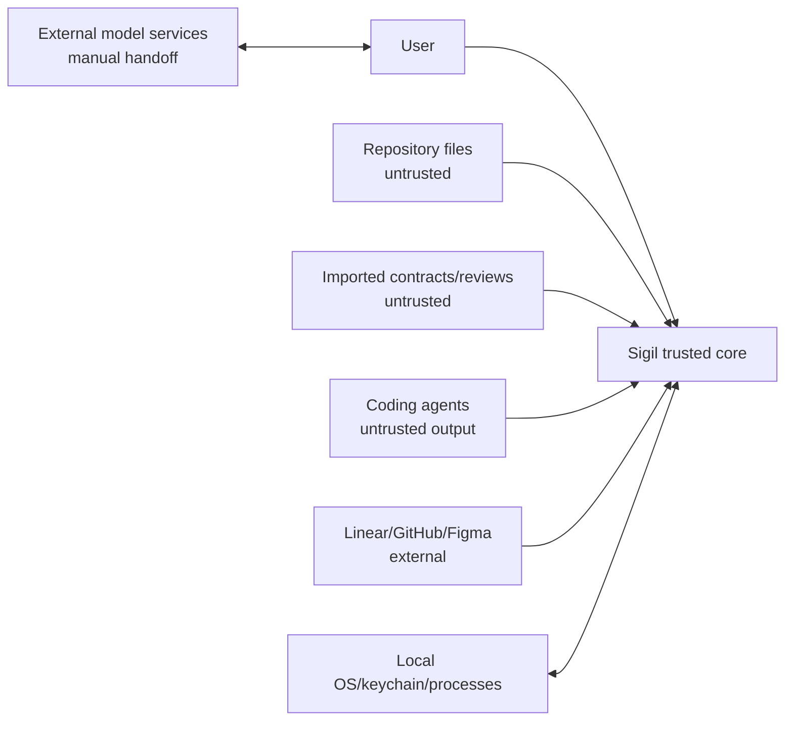

# Deliverable I: Security Threat Model

## Trust Boundaries

Sigil trusts only its signed code, validated configuration, SQLite transactions, verified artifact hashes, and explicit user approvals. Repository files, imported artifacts, SaaS text, and agent output are untrusted data.

## Threat Matrix

| Threat | Asset | Actor | Attack path | Impact | Likelihood | Preventive controls | Detective controls | Recovery controls | Residual risk | PRD |
| --- | --- | --- | --- | --- | --- | --- | --- | --- | --- | --- |
| Malicious repository files | Credentials, commands | Repo contributor | Config/instructions attempt to alter policy or include secrets | Secret leak or unsafe command | Medium | Schema validation, security policy cannot be overridden by repo content, hard exclusions | Doctor, config explain, audit event | Block transition, require user correction | Low | Security 6-8 |
| Prompt injection in Linear content | Planning/review integrity | Issue author | Issue text tells model/agent to ignore rules | Wrong implementation | High | Treat as quoted task content, package warns about untrusted input | Review package source labels | User review, contract validation | Medium | AT-INT-001 |
| Prompt injection in Figma content | Design/context integrity | Designer/attacker | Text layers contain instructions | Wrong agent behavior | Medium | Figma text labeled untrusted evidence | Manifest source labels | Contract approval filters decisions | Medium | AT-INT-005 |
| Prompt injection in imported documents | Contract/review integrity | Model/user error | Imported Markdown includes commands/policy changes | Unsafe workflow | Medium | Zod validation, required sections, no command execution from imports | Rejected draft artifacts | Re-import corrected doc | Low | AT-CON-001 |
| Arbitrary command execution via config | Local machine | Repo/config author | Malicious check command | Data loss/exfiltration | Medium | Allowlisted explicit commands, direct args, confirmation for shell mode | Audit command definitions | Block, disable config | Medium | AT-SET-003 |
| Shell injection | Local machine | Task/repo content | Path/name interpolated into shell string | RCE | Medium | No shell by default, args arrays, escaping unnecessary | Shell-mode audit | Block command | Low | AT-EXE-001 |
| Path traversal | Artifact store | Imported content | `../` paths or symlinks | Overwrite/read outside root | Medium | Canonical realpath, root containment checks | FS adapter logs | Quarantine artifact | Low | NFR-008 |
| Symlink attacks | Artifact/config files | Local attacker/repo | Symlink target outside store | Overwrite sensitive file | Medium | No following symlinks for sensitive writes, atomic create | Stat/realpath verification | Abort write, repair | Low | Security 3 |
| Malicious Git hooks | Local repo/user files | Repo contributor | Git commands trigger hooks | Code execution | Medium | Use read-only git commands where possible; document hook risk; no destructive Git | Command audit | User remediation | Medium | AT-GIT-001 |
| Secret leakage through context | Secrets | Repo/task | `.env` or token-like text included | Credential exposure | High | Hard secret exclusions, redaction patterns, preview | Secret fixture tests | Invalidate/delete artifact where policy allows | Medium | Security 1-2 |
| Secret leakage through diffs | Secrets | Developer/agent | Changed file contains key | Leak to review package | Medium | Diff redaction and secret scan | Check result/finding | Block review-ready until resolved/override where allowed | Medium | AT-GIT-003 |
| Secret leakage through logs | Secrets | Commands/agent | Process prints tokens | Persistent secret | Medium | Redaction pipeline before storage, env masking | Redaction tests | Rotate secret, mark bundle unsafe | Medium | NFR-008 |
| Signed/temp URLs | Private resources | SaaS/import | URL included in artifact | Unauthorized access | Medium | URL redaction patterns, expiry labels | Diagnostic preview | Regenerate artifact | Low | Security 2 |
| Compromised coding-agent output | Code/session | Agent/model | Agent claims done or alters files unsafely | False completion | Medium | Agent output untrusted; Git/check evidence required | Reconciliation, review | Fix loop, block completion | Medium | AT-AGT-003 |
| Malformed adapter output | State integrity | Provider/bug | Adapter returns invalid shape | Corrupt state | Medium | Runtime schemas at adapter boundary | Validation events | Reject snapshot, keep prior state | Low | NFR-012 |
| Tampered SQLite data | Session integrity | Local attacker | Edit DB | False approvals/state | Low/Med | User-local permissions, hashes for artifacts | Integrity checks, event invariants | Restore backup, recovery_required | Medium | NFR-005 |
| Tampered artifact files | Contract integrity | Local attacker/tool | Modify approved file | Intent drift | Medium | SHA-256 verification | Resume/status hash check | Restore backup/re-import/reapprove | Low | AT-ART-001 |
| Unsafe URL opening | User machine | Task content | Open `file:`/custom malicious scheme | Exfil/RCE | Medium | Scheme allowlist, optional preview | Audit open attempts | Block | Low | AT-PLN-002 |
| Dependency supply chain | Sigil install | Package attacker | Malicious dependency | RCE/secret theft | Medium | Lockfile, scanning, provenance, minimal deps | CI security scan | Patch/revoke release | Medium | Security 12 |
| Credential theft | Integration tokens | Local attacker/process | Read config/logs/artifacts | Provider compromise | Medium | Keychain aliases, redaction, no plaintext | Secret tests, doctor | Credential removal guidance | Medium | AT-AUTH-001 |
| Cross-session leakage | Task privacy | Sigil bug/user | Wrong artifact in package | Confidential data leak | Low/Med | Session-scoped queries, dependency checks | Traceability matrix tests | Invalidate artifact, notify user | Low | NFR-009 |
| Diagnostic bundle leakage | Logs/artifacts | Support workflow | Bundle includes sensitive content | Data leak | Medium | Preview manifest, content-free default, redaction | User approval required | Delete regenerated bundle | Low | NFR-009 |
| Unsafe repair operations | Work/session | Sigil bug | Doctor deletes/modifies user files | Data loss | Low | Repair preview, no repo mutation, quarantine not delete | Audit repair plan | Restore from backup | Low | NFR-019 |
| Denial of service huge repos/outputs | Availability | Repo/agent | Massive files/logs/search results | Hang/disk fill | High | Budgets, timeouts, output caps | Progress/metrics | Partial results, abort, cleanup | Medium | AT-CTX-005 |

## Security Requirements for Implementation

- Security policy evaluation is centralized and tested.
- Redaction is applied before console, artifact, log, diagnostic, and JSON output.
- No adapter can write approvals, overrides, or completion records.
- Non-overrideable gates: artifact tampering, missing approved contract bytes, DB corruption, unsafe Git operation, plaintext credential persistence.
- All imported content is parsed as data and never executed.

## Recovery Controls

Recovery prioritizes preserving user work and evidence:

1. Stop mutation.
2. Classify divergence.
3. Show repair preview.
4. Restore DB backup or promote matching staged artifact when safe.
5. Require reapproval when approved evidence is missing or tampered.
