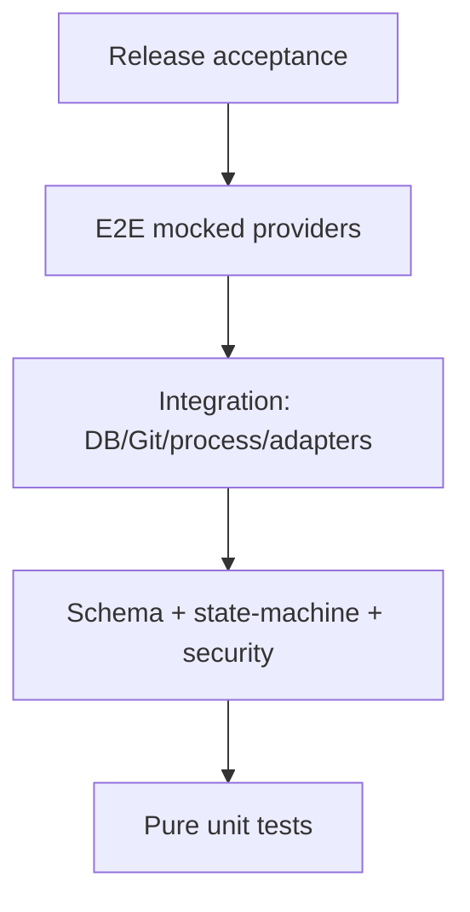

# Deliverable J: Testing Strategy

## Test Categories

| Category | Purpose | PRD coverage | Run cadence |
| --- | --- | --- | --- |
| Unit tests | Domain invariants, services, redaction, ranking | AT-SET-003, AT-CTX-002, NFR-008 | Per commit |
| State-machine tests | Valid/invalid transitions, overlays, gates | AT-SES-002, AT-APP-001, AT-CMP-001 | Per commit |
| Property-based tests | Transition invariants, path normalization, hash determinism | NFR-004, NFR-006 | PR/nightly |
| Schema validation | Artifact/import/adapter schemas | AT-CON-001, AT-REV-002, NFR-018 | Per commit |
| DB migration tests | Fresh install, upgrade, failed migration restore | NFR-017 | PR |
| Crash-injection tests | Kill between artifact/DB/write stages | AT-SES-001, NFR-011 | PR/nightly |
| Forced-termination tests | Kill process during each state-changing command | NFR-004, NFR-011 | Nightly/release |
| Filesystem failure tests | Rename/write/permission/hash mismatch failures | NFR-005 | PR/nightly |
| Adapter contract tests | Capability, errors, redaction, version checks | AT-AGT-001, AT-AUTH-002 | PR |
| Mock provider tests | Linear/GitHub/Figma fixture normalization | AT-INT-001, AT-INT-004, AT-INT-005 | PR |
| Real-provider smoke tests | Credential/scopes/API changes | AT-AUTH-002, AT-INT-* | Dedicated secure env/nightly |
| Git safety fixtures | Dirty tree, branch collision, detached HEAD, worktree | AT-GIT-001, AT-GIT-002 | PR |
| Dirty-worktree fixtures | Blocks and non-destructive choices | AT-GIT-001 | PR |
| Worktree/detached HEAD fixtures | Correct repo facts and blocks | AT-CTX-001 | PR |
| Branch-collision fixtures | Naming/adoption behavior | AT-GIT-001 | PR |
| Process cancellation tests | Graceful/escalated termination | AT-EXE-001, AT-AGT-003 | PR/nightly |
| Timeout tests | Command/provider/context timeouts | AT-CTX-005, AT-EXE-001 | PR |
| Secret-redaction tests | Logs/artifacts/diffs/diagnostics | Security 1-2, NFR-008 | Per commit |
| Telemetry contract tests | Product telemetry schemas and content exclusions | NFR-009, OQ-012 | Per commit/PR |
| Shell-injection tests | Args arrays and shell-mode blocks | Security 7, AT-EXE-001 | Per commit |
| Path traversal tests | Artifact/config/source paths | NFR-008 | Per commit |
| Large-repository tests | Budgets, partial manifests, timeouts | AT-CTX-005, NFR-013 | Nightly |
| Context-budget tests | No silent overflow | AT-CTX-002, NFR-014 | PR |
| Artifact corruption tests | Hash mismatch, missing files | AT-ART-001, NFR-005 | PR |
| Database corruption tests | Integrity failure and restore | NFR-011, NFR-017 | Nightly |
| Resume/reconciliation tests | External commits/config/artifact drift | AT-SES-002, AT-CTX-004 | PR/nightly |
| Cross-platform tests | Windows/macOS/Ubuntu behavior | NFR-016 | PR matrix/release |
| CLI snapshot tests | Help, errors, status, JSON output | AT-SET-001, NFR-018 | Per commit |
| JSON output contract tests | Stable machine output | NFR-018 | Per commit |
| End-to-end tests | Walking skeleton and full mocked V1 | AT-E2E-* | PR/release |
| Release acceptance tests | PRD release criteria | Section 37 | Before release |

## Test Pyramid

## Per-Commit Required Suite

- Unit tests for changed packages.
- State transition matrix tests.
- Zod schema tests and golden invalid imports.
- Redaction, shell-injection, path traversal tests.
- Telemetry schema/content-exclusion tests.
- CLI help/version/error snapshot tests.
- JSON output contract snapshots.

Target: fast enough for local pre-push.

## Pull Request Suite

- Full unit and schema suite.
- SQLite migration fresh/upgrade tests.
- Git fixture matrix.
- Process cancellation/timeout tests.
- Context budget and deterministic ranking tests.
- Mock Linear/GitHub/Figma adapter tests.
- Walking-skeleton E2E.
- OS matrix at least Windows, macOS, Ubuntu for core packages.

## Nightly Suite

- Forced termination at every state-changing transition.
- Large repository synthetic scan.
- Database corruption/restore.
- Real provider smoke tests in secure environment.
- Long-running agent/check cancellation tests.
- Dependency vulnerability scan.
- Telemetry event taxonomy regression tests.

## Before Release

- Full PR + nightly suites.
- End-to-end intake -> plan -> contract approval -> mock/direct agent adapter -> checks -> review -> fix -> completion on two representative pilot repos.
- Security review fixtures: secret leak, shell injection, path traversal, unsafe Git.
- Telemetry privacy review: verify no content-bearing fields and disable/preview behavior.
- Migration from previous release candidate with backup restore.
- Packaging install tests.

## Real External Service Tests

Run only in dedicated secure environments with least-privilege tokens:

- Linear: read fixture issue, comments, links.
- GitHub: read repo/PR metadata.
- Figma: parse URL and fetch metadata for fixture file/node.
- Agent CLIs: version/capability smoke; full invocation only with disposable repo.

No source code, task content, or production credentials are used.

## State-Machine Invariants

- No implementation run without approved contract hash.
- No completion without explicit completion approval.
- Paused sessions reject forward transitions.
- Cancelled sessions are inspect/export only.
- Repeating deterministic generation with same inputs yields equivalent output/hash.
- Stale Git/check/context facts block readiness labels unless permitted override exists.

## Crash-Injection Points

- After lock acquired.
- After artifact staging.
- After DB transaction before artifact promote.
- During artifact promote.
- During child process.
- During check run.
- During review import.
- During approval write.
- During migration.

Expected outcome: previous or next valid state, never ambiguous half-state.

## Acceptance Scenario Mapping

| PRD acceptance | Test evidence |
| --- | --- |
| AT-E2E-001 to 005 | Intake/context/contract E2E and schema tests |
| AT-E2E-006 to 010 | Git safety, agent run, checks, stale review fixtures |
| AT-E2E-011 to 012 | Review/finding disposition/fix loop tests |
| AT-E2E-013 to 015 | Crash/recovery/external divergence tests |
| AT-E2E-016 | Offline-mode E2E |
| AT-E2E-017 | Secret fixture tests |
| AT-E2E-018 | Unsafe Git command block tests |
| AT-E2E-019 to 020 | Completion gate tests |
| AT-E2E-021 | Non-interactive JSON exit-code tests |
| AT-E2E-022 | Migration backup/restore tests |
