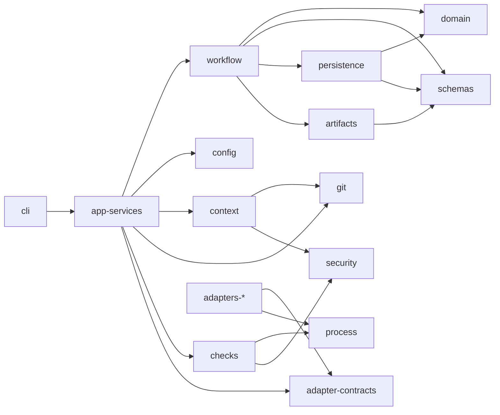

# Deliverable K: Repository and Package Structure

## Recommendation

Use a `pnpm` workspace monorepo. Even if V1 ships as one CLI, package boundaries prevent provider adapters and IO code from controlling core state.

## Proposed Directory Tree

```text
sigil/
  package.json
  pnpm-workspace.yaml
  tsconfig.base.json
  sigil.config.schema.json
  docs/
  packages/
    cli/
      src/
        commands/
        output/
        index.ts
    app-services/
      src/
        start-task.ts
        context-service.ts
        planning-service.ts
        contract-service.ts
        implementation-service.ts
        checks-service.ts
        review-service.ts
        completion-service.ts
        resume-service.ts
    domain/
      src/
        ids.ts
        state.ts
        gates.ts
        errors.ts
        value-objects.ts
    workflow-engine/
      src/
        transition-table.ts
        guard-evaluator.ts
        invalidation.ts
        approvals.ts
        overrides.ts
    schemas/
      src/
        artifacts.ts
        config.ts
        adapters.ts
        cli-json.ts
    persistence/
      src/
        db.ts
        migrations/
        repositories/
        unit-of-work.ts
        locks.ts
    artifacts/
      src/
        artifact-service.ts
        markdown-renderer.ts
        hash.ts
        storage-layout.ts
    config/
      src/
        loader.ts
        merger.ts
        validator.ts
        explain.ts
    security/
      src/
        redaction.ts
        policy.ts
        path-safety.ts
        secret-scan.ts
    diagnostics/
      src/
        logger.ts
        events.ts
        bundle.ts
    git/
      src/
        git-adapter.ts
        diff.ts
        safety.ts
    context-discovery/
      src/
        discovery-pipeline.ts
        ranker.ts
        budgets.ts
        fingerprints.ts
        profiles/
    process-runner/
      src/
        runner.ts
        cancellation.ts
        logs.ts
    checks/
      src/
        check-runner.ts
        design-policy-scanner.ts
    adapter-contracts/
      src/
        linear.ts
        github.ts
        figma.ts
        coding-agent.ts
        credentials.ts
        clipboard.ts
        opener.ts
        notifications.ts
        filesystem.ts
        clock.ts
    adapters-linear/
    adapters-github/
    adapters-figma/
    adapters-claude-code/
    adapters-codex/
    adapters-os/
      src/
        clipboard/
        opener/
        keychain/
        notifications/
        filesystem/
    test-utils/
      src/
        fixtures/
        temp-repo.ts
        fake-clock.ts
        crash-harness.ts
```

## Responsibility Boundaries

| Package | Responsibility |
| --- | --- |
| `cli` | Parse commands, prompt/confirm, render text/JSON, map errors to exit codes. |
| `app-services` | Use-case orchestration; no provider-specific logic. |
| `domain` | Pure state, invariants, errors, value objects. |
| `workflow-engine` | Transition table, gate evaluation, invalidation, approvals/overrides. |
| `schemas` | Zod schemas and JSON output contracts. |
| `persistence` | SQLite, migrations, locks, repositories, unit-of-work. |
| `artifacts` | Artifact rendering, hashing, atomic storage, dependency metadata. |
| `config` | Layered config loading, validation, explanation. |
| `security` | Redaction, path safety, secret scanning, command policy. |
| `diagnostics` | Structured logs/events/diagnostic bundles. |
| `git` | Safe Git facts and allowed branch/diff operations. |
| `context-discovery` | Deterministic candidate discovery, ranking, budgets. |
| `process-runner` | Child process lifecycle, logs, cancellation. |
| `checks` | Configured checks and deterministic design-policy scans. |
| `adapter-contracts` | Interfaces shared by core and provider packages. |
| `adapters-*` | Concrete external integrations. |
| `test-utils` | Fixtures, temp repos, fake providers, crash harness. |

## Allowed Dependency Directions



Rules:

- `domain` imports no Sigil package except tiny shared type utilities if needed.
- `workflow-engine` cannot import concrete adapters.
- `adapters-*` cannot import `workflow-engine`, `persistence`, or `cli`.
- `cli` does not directly import concrete provider SDKs.
- `process-runner` does not interpret workflow state.
- Circular dependencies are CI failures.

## Provider-Specific Isolation

Provider-specific metadata must stay in adapter result extension fields or integration snapshot artifacts. Adding a provider must not require new workflow states. If a provider needs a new capability, add it to adapter contracts and gate it by capability detection.

## Build and Test Boundaries

- Each package has independent unit tests.
- Integration tests compose packages through public interfaces.
- Fixture providers live in `test-utils`, not production packages.
- The CLI package depends on built package exports, matching published usage.
